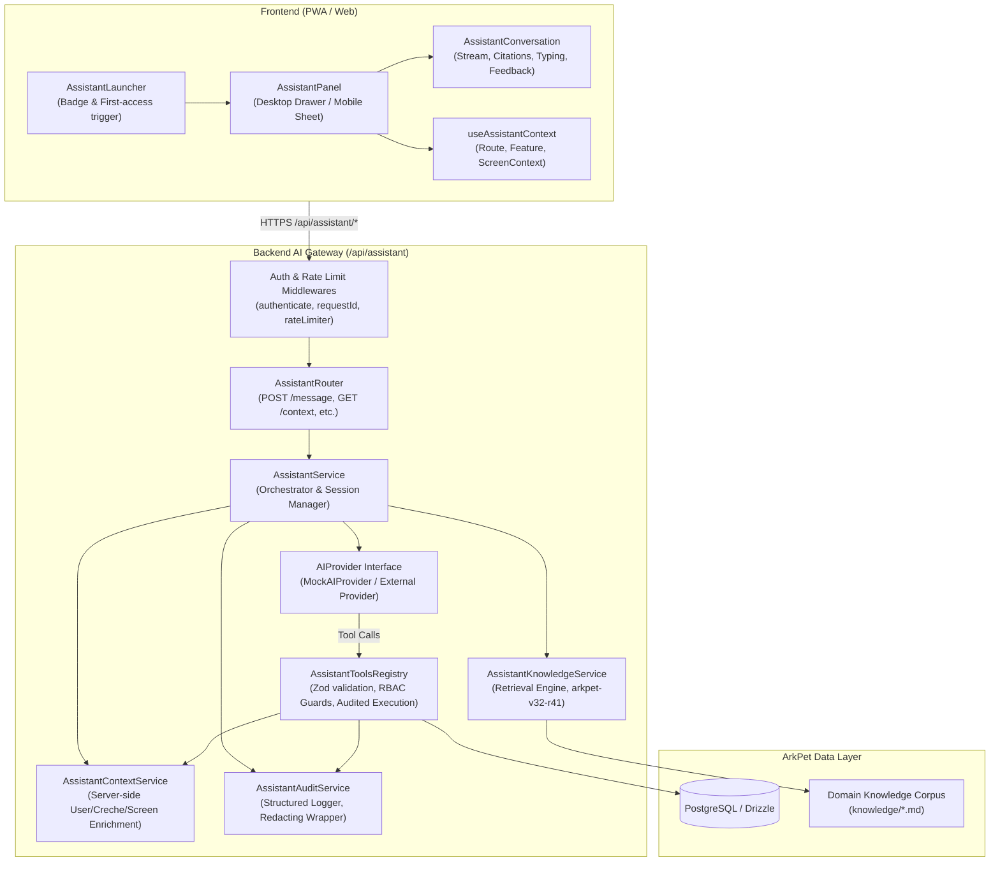

# ARKPET — R41.A ARCHITECTURE SPECIFICATION
## NATIVE AI PRODUCT COPILOT FOUNDATION

**Program:** R41 — ArkPet Intelligent Assistant  
**Phase:** R41.A — Assistant Foundation  
**Product Name:** ArkPet Assistente  
**Technical Codename:** ArkPet AI  
**Release Base SHA:** `58b4ff0e5cabd958d0f601af202378900427caab`  
**Branch:** `development/arkpet-r41-intelligent-assistant`  
**Knowledge Version:** `arkpet-v32-r41`  
**Prompt Version:** `r41-a-1`  

---

## 1. EXECUTIVE ARCHITECTURE OVERVIEW

The ArkPet Intelligent Assistant is an integrated Product Copilot designed to guide users, explain system features, answer questions, provide contextual help, and execute authorized read-only inspection tools within the ArkPet PWA ecosystem.

Unlike external or disconnected chat widgets, the ArkPet Assistant is deeply integrated into the ArkPet application lifecycle:
- **Client-Side:** Responsive App Shell integration (desktop side drawer, mobile bottom sheet), lightweight launcher with status badge, accessible ARIA dialogs, keyboard navigation, and optimistic message rendering.
- **Server-Side:** Centralized AI Gateway mounted at `/api/assistant`, authenticated via existing JWT sessions, secured by role-based access control (RBAC), enriched with server-resolved tenant context, grounded in versioned markdown knowledge retrieval, and audited through structured logging.
- **Provider Abstraction:** Decoupled AI provider interface (`AIProvider`) allowing deterministic, zero-cost mock execution in automated tests and CI, while supporting production LLM providers via backend-only environment configurations.

---

## 2. INTEGRATION MAP WITH EXISTING ARPET SUBSYSTEMS

| Subsystem | Existing Component | R41.A Integration Point | Responsibility / Behavior |
| :--- | :--- | :--- | :--- |
| **Authentication & RBAC** | `middlewares/authenticate.ts`, `lib/auth.ts` | `/api/assistant/*` | All assistant endpoints require valid JWT. `req.user` populates `userId`, `role`, `crecheId`. Unauthenticated calls are rejected with 401. |
| **Tenant Isolation** | Multi-tenant schema (`crecheId`), `requireCrecheMembership.ts` | `assistant-tools.registry.ts`, `assistant-context.service.ts` | Server enforces `crecheId` scoping. Tools never query cross-tenant data. Tutors are strictly restricted to their own pets and bookings. |
| **Onboarding Domain** | `routes/creches.ts` (`getCrecheOnboardingHandler`) | Tool `get_onboarding_status` | Returns canonical domain-derived onboarding steps (`creche_details`, `staff`, `tutors`, `pets`, `bookings`). No duplicate JSON state (`ASSISTANT_DUPLICATE_ONBOARDING_STATE = 0`). |
| **App Layout** | `components/layout/app-layout.tsx` | Lazy `<AssistantContainer />` mounted within `AppLayout` | Provides launcher in header/floating position and drawer/sheet panel. Visible across all authenticated routes. |
| **Design System** | Tailwind CSS v4, `components/ui/*`, R39 Neutral Theme | Assistant UI components | Adheres strictly to ArkPet R39 design tokens, color palette, borders, typography, and accessibility conventions. |
| **Observability** | `middlewares/requestId.ts`, `lib/logger.ts` | `assistant-audit.service.ts` | Every assistant invocation, tool execution, and error logs structured JSON with `requestId`, `userId`, `crecheId`, and tool name. PII and tokens redacted. |

---

## 3. COMPONENT BREAKDOWN & RESPONSIBILITIES

### 3.1 Backend Modules (`artifacts/api-server/src/assistant/`)

1. **`assistant.config.ts`**:
   - Feature flags: `AI_ASSISTANT_ENABLED` (boolean, defaults to true, controllable via env).
   - Voice flag: `AI_ASSISTANT_VOICE_ENABLED` (strictly false in R41.A).
   - Actions flag: `AI_ASSISTANT_ACTIONS_ENABLED` (strictly false for mutations in R41.A).
   - Global kill switch: `ASSISTANT_KILL_SWITCH` (if true, gateway returns 503 Service Unavailable without breaking the rest of the application).

2. **`assistant.provider.ts`**:
   - `AIProvider` TypeScript interface:
     - `generateResponse(options: GenerateResponseOptions): Promise<AssistantResponse>`
   - `MockAIProvider`: Deterministic, zero external network dependency, zero cost provider. Interprets user prompts, invokes matching tools via the registry, consults knowledge service, and generates structured copilot replies. Default for all automated tests.
   - `OpenAICompatibleProvider`: Configurable provider invoking OpenAI/compatible endpoints when `OPENAI_API_KEY` is present.

3. **`assistant.service.ts`**:
   - Session management: In-memory session store mapped by `sessionId` (or `userId` fallback).
   - Conversation turn pipeline:
     1. Validate session and user authorization.
     2. Retrieve relevant domain knowledge snippets via `assistant-knowledge.service.ts`.
     3. Assemble server context (`user`, `creche`, `screenContext`).
     4. Build system prompt (`ARKPET_ASSISTANT_PROMPT_VERSION = r41-a-1`).
     5. Call provider to generate response (handling tool execution loop).
     6. Audit conversation turn and return payload to client.

4. **`assistant-context.service.ts`**:
   - Gathers authenticated metadata:
     - User identity: `userId`, `name`, `email`, `role`, `crecheId`.
     - Creche metadata: `name`, `status`.
     - Screen context: Sanitized path (`/pets`, `/bookings`, `/settings`, etc.), feature identifier, allowed actions.

5. **`assistant-tools.registry.ts`**:
   - Maintains dictionary of registered read-only tools:
     - `get_onboarding_status` (roles: `creche_admin`, `master_admin`)
     - `get_current_user_context` (roles: all)
     - `get_current_screen_context` (roles: all)
     - `search_arkpet_knowledge` (roles: all)
     - `list_my_pets` (roles: `tutor`, `creche_admin`, `staff`)
     - `list_my_bookings` (roles: `tutor`, `creche_admin`, `staff`)
   - Schema enforcement via Zod.
   - Server-side RBAC validation before execution.
   - Strictly rejects unregistered tools (`UNREGISTERED_TOOL_EXECUTION = 0`).
   - Zero generic database tools (`GENERAL_DB_ACCESS_TOOL = 0`).

6. **`assistant-knowledge.service.ts`**:
   - Loads and parses versioned markdown documents from `knowledge/` folder.
   - Implements keyword and category matching to retrieve only the 1-3 most relevant snippets (`FULL_KNOWLEDGE_PROMPT_INJECTION = NO`).
   - Reports `knowledgeVersion = arkpet-v32-r41`.

7. **`assistant-audit.service.ts`**:
   - Logs structured events: `assistant_message_created`, `assistant_tool_executed`, `assistant_tool_failed`, `assistant_error`.
   - Strips authorization headers, passwords, and sensitive keys.

8. **`assistant.router.ts`**:
   - Mounted at `/api/assistant`.
   - `POST /api/assistant/message`: Primary textual message endpoint.
   - `GET /api/assistant/context`: Returns current server-resolved user and screen context.
   - `GET /api/assistant/onboarding`: Returns canonical onboarding progress.
   - `POST /api/assistant/session`: Initializes or resets conversation session.

---

### 3.2 Frontend Modules (`artifacts/petdaycare/src/features/assistant/`)

1. **`AssistantLauncher.tsx`**:
   - Floating trigger button fixed at bottom-right (z-40) with subtle icon and tooltip.
   - Includes first-access greeting banner that shows once and can be dismissed or opened.
   - Fully keyboard accessible (`aria-label="Abrir assistente ArkPet"`).

2. **`AssistantPanel.tsx`**:
   - Desktop view: Slide-over right drawer (420px width), non-modal or overlay mode, doesn't permanently obstruct main content.
   - Mobile view: Full-height bottom sheet / modal with swipe-down dismissal and safe area insets.
   - ARIA landmarks (`role="dialog"`, `aria-labelledby`, focus trap on open, restore focus on close).

3. **`AssistantConversation.tsx`**:
   - Chat message list with user bubble and assistant bubble.
   - Renders markdown formatting, bullet points, and clean navigation action suggestions.
   - Shows knowledge citations (`"Baseado em: [Seção]"`).
   - Includes `AssistantTypingState` while awaiting backend response.

4. **`AssistantFeedback.tsx`**:
   - Discreete 👍 / 👎 buttons below assistant messages for quality rating.

5. **`useAssistantContext.ts`**:
   - Observes current Wouter route and maps it to screen feature definitions (`dashboard`, `pets_directory`, `pet_detail`, `bookings_calendar`, `settings`, etc.).

---

## 4. PERFORMANCE & PWA INVARIANTS

1. **Lazy Loading (`ASSISTANT_INITIAL_BUNDLE_BLOCKING = NO`)**:
   - The assistant UI is lazy loaded using `React.lazy(() => import('@/features/assistant'))`.
   - The initial critical rendering path of ArkPet contains zero assistant bundle overhead.
2. **Resilience & Graceful Degradation (`AI_FAILURE_BREAKS_ARKPET = NO`)**:
   - If the backend AI service is unavailable (HTTP 503 / 500 / network timeout), the assistant UI displays a graceful notice: *"Assistente temporariamente indisponível."*
   - Core ArkPet functionality (pets, bookings, check-in, billing) continues functioning without interruption.
3. **Offline State**:
   - When offline, the launcher shows an offline indicator and the panel renders an informative offline card explaining that AI assistance requires an active internet connection.

---

## 5. R41.A ARCHITECTURAL GATES & METRICS

| Metric / Gate | Required Value | Architectural Status |
| :--- | :--- | :--- |
| `R41_A_VOICE_RUNTIME` | `NOT_IMPLEMENTED` | Certified (Voice deferred to R41.D) |
| `GENERAL_DB_ACCESS_TOOL` | `0` | Certified (Zero generic DB access) |
| `AI_SECRET_FRONTEND_EXPOSURE` | `0` | Certified (Secrets backend-only) |
| `NEW_AUTH_ROLE_VALUES` | `0` | Certified (Exact 4 canonical roles) |
| `ASSISTANT_DUPLICATE_ONBOARDING_STATE` | `0` | Certified (Canonical domain logic) |
| `ASSISTANT_KILL_SWITCH` | `YES` | Certified (Global toggle supported) |
| `FULL_KNOWLEDGE_PROMPT_INJECTION` | `NO` | Certified (RAG snippet retrieval) |
| `KNOWLEDGE_VERSION` | `arkpet-v32-r41` | Certified |
| `PROMPT_VERSION` | `r41-a-1` | Certified |
| `ASSISTANT_INITIAL_BUNDLE_BLOCKING` | `NO` | Certified (React.lazy) |
