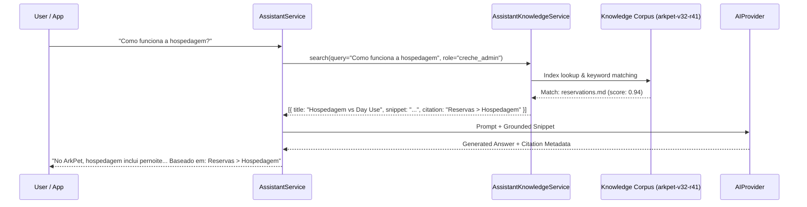

# ARKPET — R41.A KNOWLEDGE ARCHITECTURE & RETRIEVAL SPECIFICATION
## GROUNDED PRODUCT INTELLIGENCE & DOMAIN CORPUS

**Program:** R41 — ArkPet Intelligent Assistant  
**Phase:** R41.A — Assistant Foundation  
**Corpus Version:** `arkpet-v32-r41`  
**Release Base SHA:** `58b4ff0e5cabd958d0f601af202378900427caab`  

---

## 1. KNOWLEDGE SUBSYSTEM OBJECTIVES

The ArkPet Assistant must answer questions about system features accurately without hallucinating imaginary capabilities.

### Invariants:
1. **No Massive Prompt Dumps (`FULL_KNOWLEDGE_PROMPT_INJECTION = NO`)**:
   Instead of cramming the entire product manual into every model prompt, a targeted retrieval pass extracts only the 1 to 3 snippets relevant to the user's intent.
2. **Strict Knowledge Versioning (`KNOWLEDGE_VERSION = arkpet-v32-r41`)**:
   Every retrieved context item references the pinned release version to ensure documentation parity with the current software release.
3. **Zero Invented Features (`INVENTED_FEATURE_RATE_TARGET = 0`)**:
   When queried about unsupported, fictional, or future capabilities (e.g. drone delivery, canine brainwave analysis, cryptocurrency checkout), the assistant firmly responds:
   *"Não encontrei essa funcionalidade no ArkPet."*

---

## 2. DOMAIN CORPUS INVENTORY

The knowledge base is organized into domain-specific markdown files located in `artifacts/api-server/src/assistant/knowledge/`:

| Document | Domain Coverage | Key Entities & Workflows |
| :--- | :--- | :--- |
| **`reservations.md`** | Bookings & Scheduling | Diferença entre Hospedagem (pernoite) e Day Use (diária); status de reservas (`pending`, `confirmed`, `checked_in`, `checked_out`, `cancelled`); serviços adicionais. |
| **`pets.md`** | Pet Management | Cadastro de pet; vínculo obrigatório com tutor; raça, espécie, porte; vacinas, alergias, medicações e restrições comportamentais; foto de perfil. |
| **`chat.md`** | In-App Messaging | Mensagens entre tutor e creche; canais diretos por pet ou gerais; envio de fotos e vídeos; notificações de novas mensagens. |
| **`roles.md`** | Permissions & RBAC | Os 4 papéis canônicos: `master_admin`, `creche_admin`, `staff`, `tutor`; permissões operacionais vs administrativas. |
| **`onboarding.md`** | Daycare Setup | Os 5 passos canônicos de onboarding: 1) Dados da creche, 2) Equipe/staff, 3) Tutores, 4) Pets, 5) Reservas. |
| **`notifications.md`** | Push & In-App Alerts | Notificações push via Service Worker / VAPID; alertas de check-in, check-out, alimentação, medicação e avisos financeiros. |
| **`financial.md`** | Billing & Ledger | Planos ArkPet via Stripe (assinatura da creche); faturamento e cobrança de mensalidades dos tutores; faturas e comprovantes. |
| **`settings.md`** | Daycare Configuration | Dados cadastrais, endereço, telefone, horários de check-in/check-out, capacidade máxima de pets. |

---

## 3. RETRIEVAL & GROUNDING PIPELINE

### Retrieval Scoring:
- Keyword intersection and token stemming.
- Category tag matching (e.g. `reservas`, `pets`, `chat`, `onboarding`).
- Role filtering (e.g. tutors do not receive snippets regarding master admin billing configurations).
- Thresholding: Queries with zero relevant matches return empty context, triggering the model's standard non-invented fallback response.
