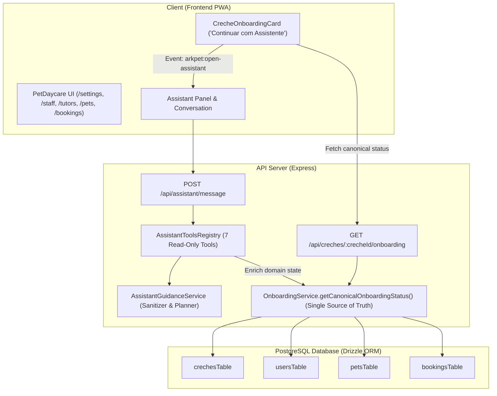

# ARKPET — R41.B ARCHITECTURE
## AI Guided Onboarding Copilot Architecture & Single Server-Side Source of Truth

**Phase:** R41.B — AI Guided Onboarding  
**Baseline SHA:** `fb8ed90f3b31358464ea22dce07655b46961934b`  
**Implementation SHA:** `e76e704d5bd1ae9e22d6c6f9eb5f1320b7971d05`  
**Date:** 2026-10-01  
**Status:** FULLY CERTIFIED  

---

## 1. Architectural Overview

The ArkPet Intelligent Assistant transitions in R41.B from a question/answer copilot into an **AI Guided Onboarding Copilot** for daycare administrators (`creche_admin`).

The core guiding principle is:
> **"GUIDE, not DO FOR ME"**  
> The assistant actively guides the administrator through the setup steps with screen awareness and target element highlighting, but does **not** perform automatic database mutations (`R41_B_DOMAIN_MUTATION_COUNT = 0`).



---

## 2. Single Server-Side Source of Truth (`onboarding.service.ts`)

To eliminate duplicate state calculation (`ASSISTANT_DUPLICATE_ONBOARDING_STATE = 0`), the domain logic is unified in:
`artifacts/api-server/src/services/onboarding.service.ts`

Both the canonical REST endpoint (`GET /api/creches/:crecheId/onboarding` in `routes/creches.ts`) and the AI Assistant (`AssistantToolsRegistry.getOnboardingStatus`) invoke:
```ts
getCanonicalOnboardingStatus(
  crecheId: number,
  dbInstance?: Database
): Promise<CanonicalOnboardingStatus | null>
```

### The 5 Canonical Steps and Completion Rules:
1. **`creche_details`**: `Boolean(creche.phone && creche.address)` (settings route `/settings`)
2. **`staff`**: `staffMembersCount > 1` (must have at least one additional staff beyond admin, route `/staff/manage`)
3. **`tutors`**: `tutorsCount > 0` (tutors route `/tutors`)
4. **`pets`**: `petsCount > 0` (pets route `/pets`)
5. **`bookings`**: `bookingsCount > 0` (bookings route `/bookings`)

---

## 3. Assistant Guidance Enrichment

The assistant never re-queries the database independently to compute step completion. Instead, it **enriches** the canonical output:
- **`target`**: Identifies the DOM button or form to highlight on that step's page.
- **`progressPercent`**: `Math.round((completedCount / totalSteps) * 100)`.
- **`completedSteps`**: Array of completed step IDs.
- **`pendingSteps`**: Array of incomplete step IDs.
- **`currentStep`**: The first pending step in chronological sequence.

```ts
export interface GuidedOnboardingStatus {
  crecheId: number;
  isComplete: boolean;
  completedCount: number;
  totalSteps: number;
  progressPercent: number;
  completedSteps: CanonicalOnboardingStepId[];
  pendingSteps: CanonicalOnboardingStepId[];
  currentStep: GuidedOnboardingStep | null;
  steps: GuidedOnboardingStep[];
}
```

---

## 4. Multi-Provider AI Architecture

Preserved identically from R41.A certification:
- **`MockAIProvider`**: Default provider in automated test environments (`NODE_ENV=test`).
- **`GroqProvider`**: Default runtime provider (`AI_PROVIDER=groq`, model `openai/gpt-oss-20b`).
- **`OpenAIProvider`**: Production fallback option (`AI_PROVIDER=openai`).
- **Fail-Closed Runtime**: Missing keys or unrecognized providers fail closed (`RUNTIME_FALLBACK_PROVIDER = NONE`).

---

## 5. UI Action Contract & Screen Awareness

The assistant emits structured `uiActions` attached to messages:
```ts
export type AssistantUIAction =
  | { type: "navigate"; route: string }
  | { type: "highlight"; targetId: string }
  | { type: "scroll_to"; targetId: string };
```

- When the user is **already on the step's route** (e.g. `/pets`), the assistant acknowledges the screen and emits only `{ type: "highlight", targetId: "pet-create-button" }`.
- When the user is on a **different route** (e.g. `/`), the assistant emits navigation chips: `{ type: "navigate", route: "/pets" }` and `{ type: "highlight", targetId: "pet-create-button" }`.
- Client-side navigation is restricted to relative application routes in the strict allowlist (`ARBITRARY_NAVIGATION = 0`, `ASSISTANT_EXTERNAL_REDIRECT = 0`).
- Target elements are restricted to verified step IDs (`ARBITRARY_CSS_SELECTOR_FROM_MODEL = 0`).

---

## 6. Zero Mutation Boundary

- **`R41_B_DOMAIN_MUTATION_COUNT = 0`**: No assistant tool creates, edits, or deletes domain records.
- **`GENERAL_DB_ACCESS_TOOL = 0`**: No SQL, raw query, or database execution tools are registered.
- **`R41_B_TOOL_COUNT = 7`**: Exactly 7 read-only tools registered in `AssistantToolsRegistry`.
