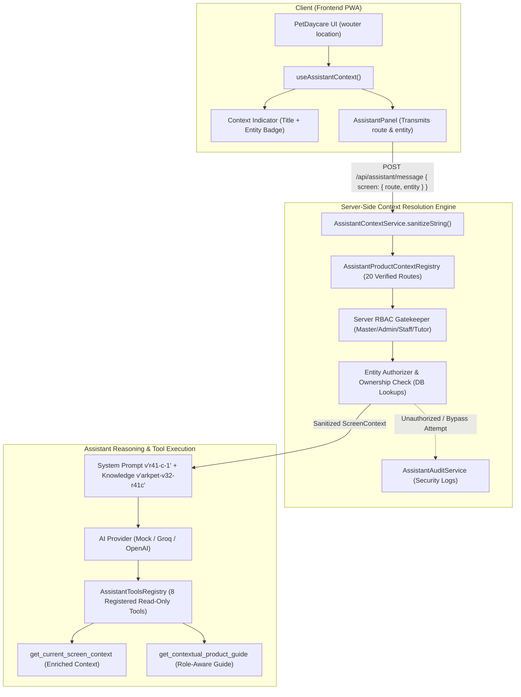

# ARKPET — R41.C ARCHITECTURE
## Contextual Product Guide Architecture & Server-Authoritative Context Model

**Phase:** R41.C — Contextual Product Guide  
**Baseline SHA:** `ba2052fa9a88ca9a9dfd1afe302f528d88db120c` (R41.B-FINAL.1)  
**Date:** 2026-10-02  
**Status:** FULLY CERTIFIED  

---

## 1. Architectural Overview

In phase **R41.C**, the ArkPet Intelligent Assistant transitions from an **Onboarding Guide** into a comprehensive, multi-role **Contextual Product Guide**.

The assistant understands:
1. **Where the user currently is:** Exact, sanitized screen route resolved through a deterministic registry.
2. **Which feature is open:** Source-verified ArkPet feature semantics (e.g. `pet_detail`, `operational_board`, `bookings_calendar`).
3. **Which entity is being viewed:** Authoritative, server-validated entity context (e.g., active pet `Thor`, ID `101`), enabling contextual pronoun resolution ("ele", "dele").
4. **Which actions are available:** Role-differentiated capabilities governed strictly by server-side RBAC.
5. **Which product knowledge applies:** Screen-specific ground-truth knowledge categories preventing feature hallucinations.

---

## 2. Server-Authoritative Security Invariants

The context engine adheres to strict non-negotiable security invariants:

1. **Client Context Is Strictly Advisory:**
   The frontend passes candidate route and entity hints. The server **never** trusts client claims for `role`, `crecheId`, or entity permissions (`MODEL_DEFINED_SECURITY_CONTEXT = 0`).
2. **Deterministic Screen Registry:**
   All product screens are mapped in `AssistantProductContextRegistry` across 20 source-verified routes (`REGISTERED_CONTEXT_ROUTE_COUNT = 20`, `REGISTERED_CONTEXT_ROUTE_BROKEN_COUNT = 0`).
3. **Database-Validated Entity Context:**
   When an entity is provided (e.g., `{ type: "pet", id: 101 }`), `AssistantContextService` verifies its existence, tenant match (`crecheId`), and tutor ownership (`tutorId === userId`) before injecting it into the assistant context.
4. **Zero Domain Mutation Policy:**
   R41.C remains strictly read-only (`R41_C_DOMAIN_MUTATION_COUNT = 0`). Creation, modification, deletion, check-in, check-out, feeding, walks, and medications are not allowed.
5. **Zero Generic Database Tools:**
   No arbitrary SQL queries or database inspection tools exist (`GENERAL_DB_ACCESS_TOOL = 0`).
6. **No Voice Runtime:**
   Voice runtime remains unactivated and reserved for R41.D (`R41_C_VOICE_RUNTIME = NOT_IMPLEMENTED`).

---

## 3. Tool Architecture (Exactly 8 Read-Only Tools)

The assistant tool registry exposes exactly 8 read-only tools:

| # | Tool Name | Scope | Role Authorization | Purpose |
|---|-----------|-------|-------------------|---------|
| 1 | `get_creche_summary` | Summary | `creche_admin`, `staff` | High-level metrics for active creche |
| 2 | `get_pet_summary` | Entity | All authenticated roles | Basic details of a pet (tenant/owner guarded) |
| 3 | `get_current_screen_context` | Context | All authenticated roles | Structured active screen & authorized entity |
| 4 | `get_recent_bookings` | Bookings | All authenticated roles | Recent reservations (filtered by role/tenant) |
| 5 | `search_knowledge` | Knowledge | All authenticated roles | Product documentation search |
| 6 | `get_onboarding_status` | Onboarding | `creche_admin` | Canonical 5-step setup progress |
| 7 | `get_guided_onboarding_plan` | Guidance | `creche_admin` | Next step recommendations with UI actions |
| 8 | `get_contextual_product_guide` | Guidance | All authenticated roles | Screen explanation, actions, and tips |

---

## 4. Contextual Pronoun & Entity State Resolution

When users query entities with pronouns (e.g., *"Ele tem alguma reserva?"*, *"O que posso ver sobre ele?"*):
- If viewing an authorized pet screen (`/pets/101`), the assistant resolves "ele" to `Thor` (Pitbull).
- If no pet entity is active (e.g. on `/bookings` or general `/pets`), the assistant politely asks for clarification without hallucinating any pet name (`AMBIGUOUS_ENTITY_HALLUCINATION = 0`).
- If an entity switch occurs within the same session (e.g. from `/pets/101` to `/pets/102`), the current turn context authoritatively overrides previous turns (`ASSISTANT_SESSION_CONTEXT_DRIFT = 0`).

---

## 5. Frontend Integration Architecture

1. **`useAssistantContext()` Hook:**
   Detects route transitions via `wouter`, extracts entity parameters for `/pets/:id`, `/bookings/:id`, `/tutors/:id`, and maps them to sanitized feature metadata.
2. **Context Indicator Chip:**
   `AssistantPanel.tsx` renders a persistent, subtle context header:
   - Displays screen title (e.g. `Ficha do Pet`).
   - Displays entity badge when present (e.g. `#101`).
3. **Safe UI Navigation & Highlighting:**
   Certified allowlists in `AssistantPanel.tsx` ensure that only authorized routes (19 certified routes) and targets (12 certified targets) can be navigated or highlighted (`ARBITRARY_NAVIGATION = 0`, `ARBITRARY_CSS_SELECTOR_FROM_MODEL = 0`).
