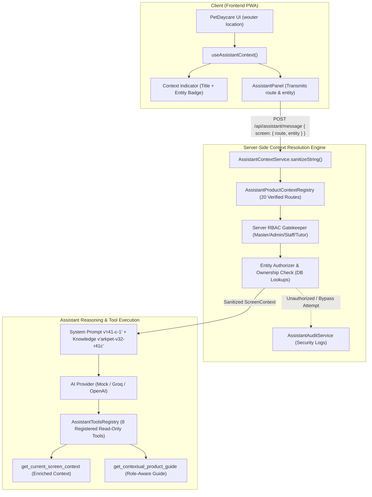

# ARKPET — R41.C ARCHITECTURE
## Contextual Product Guide Architecture & Server-Authoritative Context Model

**Phase:** R41.C — Contextual Product Guide  
**Baseline SHA:** `ba2052fa9a88ca9a9dfd1afe302f528d88db120c` (R41.B-FINAL.1)  
**Implementation SHA:** `5bba0bf23d9c1b09901fa45c0b548d76e74c2006`  
**Date:** 2026-10-02  
**Status:** IMPLEMENTATION CERTIFIED (NOT DEPLOYED)  

---

## 1. Architectural Overview

In phase **R41.C**, the ArkPet Intelligent Assistant transitions from an **Onboarding Guide** into a comprehensive, multi-role **Contextual Product Guide**.

The assistant understands:
1. **Where the user currently is:** Exact, sanitized screen route resolved through a deterministic registry.
2. **Which feature is open:** Source-verified ArkPet feature semantics (e.g. `pet_detail`, `operational_board`, `bookings_calendar`).
3. **Which entity is being viewed:** Authoritative, server-validated entity context (`SUPPORTED_CONTEXTUAL_ENTITY_RUNTIME = pet`), enabling contextual pronoun resolution ("ele", "dele") for active pets like `Thor` (ID `101`).
4. **Which actions are available:** Role-differentiated capabilities governed strictly by server-side RBAC.
5. **Which product knowledge applies:** Screen-specific ground-truth knowledge categories preventing feature hallucinations.

---

## 2. Server-Authoritative Security Invariants

The context engine adheres to strict non-negotiable security invariants:

1. **Client Context Is Strictly Advisory:**
   The frontend passes candidate route and entity hints. The server **never** trusts client claims for `role`, `crecheId`, or entity permissions (`MODEL_DEFINED_SECURITY_CONTEXT = 0`).
2. **Deterministic Screen Registry:**
   All product screens are mapped in `AssistantProductContextRegistry` across 20 source-verified routes (`REGISTERED_CONTEXT_ROUTE_COUNT = 20`, `REGISTERED_CONTEXT_ROUTE_BROKEN_COUNT = 0`).
3. **Database-Validated Entity Context:**
   When a pet entity is provided (e.g., `{ type: "pet", id: 101 }`), `AssistantContextService` verifies its existence, tenant match (`crecheId`), and tutor ownership (`tutorId === userId`) before injecting it into the assistant context.
4. **Supported Entity Runtime Scope:**
   Currently, only `pet` entities resolve dynamically in runtime (`SUPPORTED_CONTEXTUAL_ENTITY_RUNTIME = pet`). Fictitious entity route parsers have been eliminated (`FRONTEND_FICTITIOUS_ENTITY_ROUTE_PARSERS = 0`).
5. **Zero Domain Mutation Policy:**
   R41.C remains strictly read-only (`R41_C_DOMAIN_MUTATION_COUNT = 0`). Creation, modification, deletion, check-in, check-out, feeding, walks, and medications are not allowed.
6. **Zero Generic Database Tools:**
   No arbitrary SQL queries or database inspection tools exist (`GENERAL_DB_ACCESS_TOOL = 0`).
7. **No Voice Runtime:**
   Voice runtime remains unactivated and reserved for R41.D (`R41_C_VOICE_RUNTIME = NOT_IMPLEMENTED`).
8. **Chat Transport:**
   Polling-based HTTP synchronization is used for in-app chat; real-time terminology reflects user-facing UX semantics.

---

## 3. Tool Architecture (Canonical 8 Read-Only Tools)

The assistant tool registry (`AssistantToolsRegistry`) exposes exactly 8 read-only tools matching source truth (`DOCUMENTED_TOOL_NAMES_MATCH_SOURCE = YES`, `DOCUMENTED_NONEXISTENT_TOOLS = 0`):

| # | Canonical Tool Name | Scope | Role Authorization | Purpose |
|---|---------------------|-------|-------------------|---------|
| 1 | `get_onboarding_status` | Onboarding | `creche_admin` | Canonical 5-step onboarding completion state |
| 2 | `get_current_user_context` | User Context | `master_admin`, `creche_admin`, `staff`, `tutor` | Authenticated user identity (role, tenant) |
| 3 | `get_current_screen_context` | Screen Context | `master_admin`, `creche_admin`, `staff`, `tutor` | Active screen, metadata, allowed actions, entity |
| 4 | `search_arkpet_knowledge` | Knowledge | `master_admin`, `creche_admin`, `staff`, `tutor` | Official ArkPet business rules and documentation |
| 5 | `list_my_pets` | Pets | `creche_admin`, `staff`, `tutor` | Scoped list of pets (tenant or tutor-owned) |
| 6 | `list_my_bookings` | Bookings | `creche_admin`, `staff`, `tutor` | Scoped list of reservations |
| 7 | `get_guided_onboarding_plan` | Guidance | `creche_admin` | Step-by-step guidance and safe navigation targets |
| 8 | `get_contextual_product_guide` | Guidance | `master_admin`, `creche_admin`, `staff`, `tutor` | Screen explanation, actions, and role tips |

---

## 4. Provider & Default Model Architecture

The multi-provider architecture established in R41.A is strictly preserved:

- **Source Default Provider:** `groq` (`SOURCE_DEFAULT_PROVIDER = groq`)
- **Source Default Model:** `openai/gpt-oss-20b` (`SOURCE_DEFAULT_MODEL = openai/gpt-oss-20b`)
- **Environment Override:** If `AI_MODEL` is set in the runtime environment, it takes precedence (`ACTIVE_ENV_MODEL`).
- **Runtime Fallback:** Strictly `NONE` (`RUNTIME_FALLBACK_PROVIDER = NONE`) — fail-fast design without silent provider drift.

---

## 5. Contextual Pronoun & Entity State Resolution

When users query entities with pronouns (e.g., *"Ele tem alguma reserva?"*, *"O que posso ver sobre ele?"*):
- If viewing an authorized pet screen (`/pets/101`), the assistant resolves "ele" to `Thor` (Pitbull).
- If no pet entity is active (e.g. on `/bookings` or general `/pets`), the assistant politely asks for clarification without hallucinating any pet name (`AMBIGUOUS_ENTITY_HALLUCINATION = 0`).
- If an entity switch occurs within the same session (e.g. from `/pets/101` to `/pets/102`), the current turn context authoritatively overrides previous turns (`ASSISTANT_SESSION_CONTEXT_DRIFT = 0`).

---

## 6. Frontend Integration Architecture

1. **`useAssistantContext()` Hook:**
   Detects route transitions via `wouter`, extracts entity parameters for `/pets/:id` (`entity: { type: "pet", id }`), and maps them to sanitized feature metadata.
2. **Context Indicator Chip:**
   `AssistantPanel.tsx` renders a persistent, subtle context header:
   - Displays screen title (e.g. `Ficha do Pet`).
   - Displays entity badge when present (e.g. `#101`).
3. **Safe UI Navigation & Highlighting:**
   Certified allowlists in `AssistantPanel.tsx` ensure that only authorized routes (19 certified routes) and targets (12 certified targets) can be navigated or highlighted (`ARBITRARY_NAVIGATION = 0`, `ARBITRARY_CSS_SELECTOR_FROM_MODEL = 0`).
