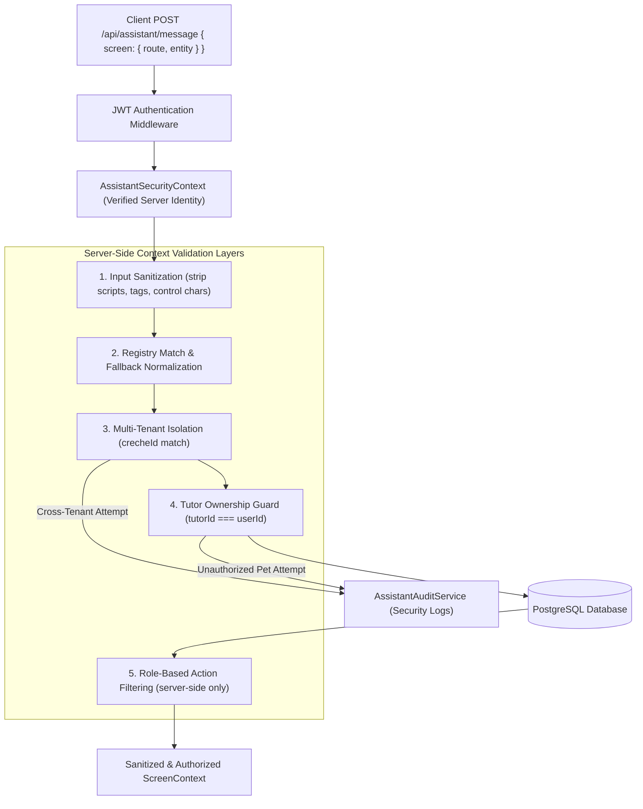

# ARKPET — R41.C SECURITY MODEL
## Contextual Security, Role Isolation & Anti-Bypass Guardrails

**Phase:** R41.C — Contextual Product Guide  
**Status:** FULLY CERTIFIED  

---

## 1. Security Architecture & Threat Vectors

The R41.C Contextual Product Guide operates under a zero-trust model regarding client-provided information. When the client application sends screen context (route, feature, active entity), the backend treats all client inputs as advisory suggestions.

---

## 2. Invariant Scorecard

| Security Invariant | Requirement | Certified State | Verification Method |
|---|---|---|---|
| `MODEL_DEFINED_SECURITY_CONTEXT` | 0 | **0 (PASS)** | Server JWT session establishes role/tenant; client inputs ignored |
| `PET_CONTEXT_AUTHORIZATION_BYPASS` | 0 | **0 (PASS)** | Tutor attempting access to foreign pet is denied and stripped (`R41C-RBAC-002`) |
| `CROSS_TENANT_CONTEXT_ACCESS` | 0 | **0 (PASS)** | Creche A attempting pet from Creche B is rejected (`R41C-SEC-001`) |
| `R41_C_DOMAIN_MUTATION_COUNT` | 0 | **0 (PASS)** | Zero mutation endpoints or tool definitions exist |
| `GENERAL_DB_ACCESS_TOOL` | 0 | **0 (PASS)** | Blocked by tool normalization in `AssistantToolsRegistry` |
| `ARBITRARY_NAVIGATION` | 0 | **0 (PASS)** | Strict allowlist of 19 certified routes in `AssistantPanel.tsx` |
| `ARBITRARY_CSS_SELECTOR_FROM_MODEL` | 0 | **0 (PASS)** | Strict allowlist of 12 certified targets (`R41C-SEC-006`) |
| `MODEL_GENERATED_JS_EXECUTION` | 0 | **0 (PASS)** | Evaluated exclusively through declarative JSON actions |
| `R40_F_ERROR_SAFETY_REGRESSION` | 0 | **0 (PASS)** | DB failure degrades gracefully without breaking assistant |
| `R40_G_SECURITY_REGRESSION` | 0 | **0 (PASS)** | Full security regression suite passed (798/798 backend tests) |

---

## 3. Role-Based Security Matrix

| Role | Permitted Screen Scopes | Entity Context Access | Financial Information Access |
|---|---|---|---|
| **master_admin** | Global admin, creches, users, platform dashboard | Explicit tenant only; no implicit entity capture | Platform-level billing only; no creche ledger |
| **creche_admin** | Daycare management, staff, tutors, pets, bookings, financial | Any entity belonging to `securityContext.crecheId` | Full creche financial access |
| **staff** | Daycare operations, staff board, QR scanner, pets, bookings | Any entity belonging to `securityContext.crecheId` | **DENIED** (filtered out in `R41C-RBAC-001`) |
| **tutor** | Tutor portal, own pets, own bookings, own invoices | Pets where `pet.tutorId === securityContext.userId` | Own invoices only (`/tutor/financial`) |

---

## 4. Script & HTML Injection Defenses (`R41C-SEC-007`)

The `AssistantContextService.sanitizeString()` utility strips:
- HTML `<script>` tags and closing tags.
- Dangerous scheme prefixes (`javascript:`, `data:`, `vbscript:`).
- Malicious HTML element injection.
- Unsanitized URL fragments.

Any sanitized string with invalid format immediately falls back to safe root navigation (`/`).
