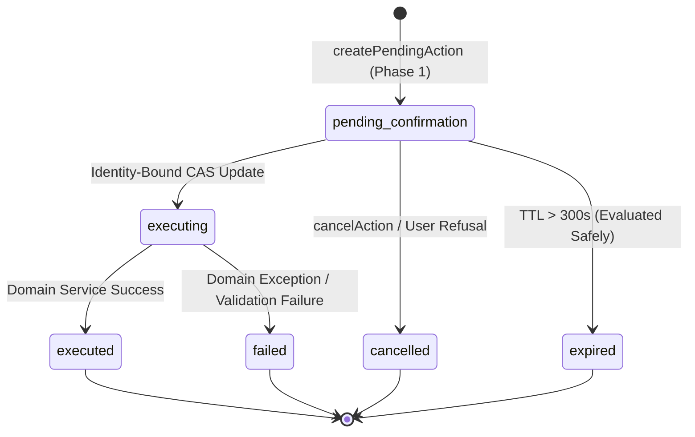

# ARKPET — R41.E ARCHITECTURE SPECIFICATION
## SAFE ACTIONS: CANONICAL PREVIEW VALIDATION, ZERO BUSINESS-RULE DUPLICATION, IDENTITY-BOUND CAS, CANONICAL DOMAIN SERVICE REUSE, DETERMINISTIC EXECUTION, RBAC & AUDIT

**Phase:** R41.E — Safe Actions (Finalized & Certified: R41.E-FINAL.2)  
**Program:** R41 — ArkPet Intelligent Assistant  
**Lineage & SHA Reconciliation:**
- `R41_D_FINAL_SHA`: `ab539ae4504d8c18d192e0bd2416805789200f1f`
- `R41_E_IMPLEMENTATION_SHA`: `55d228e41921302c794a35b4545d5af2efb8f255`
- `R41_E_FINAL1_HARDENING_SHA`: `9dc6583e16ac6e08e44224db5100c61b545f0126`
- `R41_E_FINAL1_CLOSURE_HEAD_SHA`: `9e0f689e7851b3d5fef0f13e42bad7648ae581c7`
- `R41_E_FINAL_SHA`: Forward commit HEAD (FINAL.2 Closure)  
**Status:** Certified Architecture & Fully Implemented (FINAL.2)  

---

## 1. Executive Summary

R41.E marks the transition of the ArkPet Intelligent Assistant from an informational, read-only guide into an authorized, domain-executing assistant. Because mutations carry operational, legal, and financial consequences, **no database write or domain mutation is ever executed directly from model-generated text or unverified user intent**.

Every domain mutation strictly adheres to the **Two-Phase Action Protocol**:
1. **Phase 1: PREVIEW (Proposal & Cryptographic Staging)**  
   The assistant validates schema, checks server RBAC and tenant authorization, verifies canonical domain prerequisites, calculates an opaque SHA-256 payload integrity hash, and stores an expiring `pending_confirmation` record (TTL = 300s). No domain state change or business mutation occurs in Phase 1.
2. **Phase 2: EXECUTE (Identity-Bound CAS, Canonical Domain Reuse & Audit)**  
   Upon explicit user approval (via structured UI button or unambiguous natural language confirmation), the server validates the confirmation token, enforces an **Identity-Bound Compare-And-Swap (CAS)** lock, revalidates domain state under row locks, delegates execution to **canonical domain services** (`BookingDomainService`, `TaskDomainService`), records an immutable, sanitized audit trail, and returns a sanitized result.

```
USER REQUEST (Text or Voice via Whisper STT)
   ↓
ASSISTANT INTENT RESOLUTION
   ↓
REGISTERED MUTATION TOOL (1 of 7 Canonical Tools)
   ↓
SERVER AUTHENTICATION & RBAC (Server-Enforced Against req.user)
   ↓
TENANT & RESOURCE OWNERSHIP VALIDATION
   ↓
DOMAIN STATE PREREQUISITE & AMBIGUITY CHECK
   ↓
ACTION PREVIEW GENERATION (Opaque pa_ ID + SHA-256 Payload Hash + 300s TTL)
   ↓
EXPLICIT USER CONFIRMATION (UI Confirm Button / Unambiguous "sim, confirmo")
   ↓
CONFIRMATION TOKEN VALIDATION (User ID, Tenant ID, Role Binding)
   ↓
IDENTITY-BOUND ATOMIC CAS LOCK (pending_confirmation → executing)
   [id = :id AND user_id = :userId AND creche_id = :crecheId AND role = :role AND expires_at > NOW()]
   ↓
CANONICAL DOMAIN SERVICE EXECUTION (Zero LLM Involvement)
   ├── BookingDomainService (cancelBooking, checkInBooking, checkOutBooking)
   └── TaskDomainService (completeTask, recordMedicationAdministration)
   ↓
IMMUTABLE AUDIT LOGGING (assistant_safe_action_audit, sanitized, zero stack traces)
   ↓
SAFE STRUCTURED RESULT (Generic error messages on 500, zero DB URI/token leaks)
```

---

## 2. Invariants & Guarantees

| Invariant | Certified Value | Architectural Guarantee |
|---|---|---|
| `MUTATION_WITHOUT_CONFIRMATION` | `0` | Every single mutation strictly requires explicit confirmation |
| `LLM_IN_MUTATION_EXECUTION_PATH` | `NO` | Execution after confirmation is 100% deterministic code |
| `GENERAL_DB_ACCESS_TOOL` | `0` | Prohibits SQL, raw queries, or generic database executors |
| `GENERIC_MUTATION_TOOL` | `0` | All mutations map to dedicated, narrowly typed tools |
| `MODEL_GENERATED_SQL_EXECUTION` | `0` | Zero eval, dynamic SQL, or raw ORM query building from model |
| `AI_DELETE_TOOL_COUNT` | `0` | Assistant cannot delete database rows or entities |
| `AI_FINANCIAL_MUTATION_TOOL_COUNT` | `0` | Billing/payment/financial writes are blocked |
| `STANDALONE_BATH_ACTION_TOOL` | `0` | Bath remains exclusively an add-on within booking flow |
| `MODEL_OVERRIDES_MEDICATION_DOSAGE`| `0` | Assistant cannot override medical dosage or frequency |
| `CAS_ATOMIC_AUTHORIZATION_BOUND` | `YES` | CAS transition binds user, tenant, role, and expiry atomically |
| `FOREIGN_PENDING_ACTION_STATE_MUTATION` | `0` | Unauthorized callers can never alter foreign pending actions |
| `PENDING_ACTION_ID_ENUMERATION` | `0` | Guessed or foreign IDs return safe 404 without metadata leak |
| `CROSS_USER_IDEMPOTENT_RESULT_LEAK` | `0` | Cached execution results returned only to authenticated owner |
| `STALE_AUTHORIZATION_MUTATION` | `0` | Stale role changes fail closed before domain execution |
| `ASSISTANT_DUPLICATE_MUTATION_BUSINESS_RULES` | `0` | Zero duplicate business rules across preview and execution |
| `BOOKING_CANCEL_PREVIEW_RULE_DUPLICATION` | `0` | Preview and execution share `BookingDomainService.validateCancellation` |
| `CHECK_IN_PREVIEW_RULE_DUPLICATION` | `0` | Preview and execution share `BookingDomainService.validateCheckIn` |
| `CHECK_OUT_PREVIEW_RULE_DUPLICATION` | `0` | Preview and execution share `BookingDomainService.validateCheckOut` |
| `TASK_DOMAIN_RULE_DUPLICATION` | `0` | Preview and execution share `TaskDomainService.validateTaskCompletion` |
| `PREVIEW_CANONICAL_DOMAIN_REUSE` | `PASS` | All preview proposals build directly from canonical domain service methods |
| `EXECUTION_CANONICAL_DOMAIN_REUSE` | `PASS` | All mutations execute directly via canonical domain service methods |
| `EXECUTION_REVALIDATES_DOMAIN_STATE` | `YES` | Execution revalidates domain state under transaction row locks |
| `BOOKING_MUTATION_CANONICAL_SERVICE_REUSE` | `YES` | HTTP routes and Assistant share `BookingDomainService` |
| `TASK_MUTATION_CANONICAL_SERVICE_REUSE` | `YES` | HTTP routes and Assistant share `TaskDomainService` |
| `ASSISTANT_BOOKING_CANCEL_SIDE_EFFECT_PARITY` | `PASS` | Invoice items, credits, audit, and push notifications parity |
| `RAW_SAFE_ACTION_ERROR_TO_CLIENT` | `0` | Internal 500 errors sanitized to generic client messages |
| `AUDIT_SECRET_LEAK` | `0` | Zero DB credentials, bearer tokens, or secrets in audit logs |
| `AUDIT_STACK_TRACE_STORAGE` | `0` | Zero raw stack traces stored in audit records |

---

## 3. Database Schema

The architecture uses two dedicated PostgreSQL tables defined in `lib/db/src/schema/assistantSafeActions.ts`:

### 3.1. `assistant_pending_actions`
Stores action proposals awaiting explicit user confirmation:

```ts
export const assistantPendingActionsTable = pgTable(
  "assistant_pending_actions",
  {
    id: varchar("id", { length: 64 }).primaryKey(), // pa_<uuid>
    userId: integer("user_id").notNull(),
    crecheId: integer("creche_id").notNull(),
    role: varchar("role", { length: 32 }).notNull(),
    actionType: varchar("action_type", { length: 64 }).notNull(),
    targetType: varchar("target_type", { length: 64 }).notNull(),
    targetId: integer("target_id").notNull(),
    validatedPayload: jsonb("validated_payload").notNull().$type<Record<string, any>>(),
    payloadHash: varchar("payload_hash", { length: 64 }).notNull(), // SHA-256
    status: varchar("status", { length: 32 }).notNull().default("pending_confirmation"),
    previewData: jsonb("preview_data").notNull().$type<Record<string, any>>(),
    summary: text("summary").notNull(),
    requestId: varchar("request_id", { length: 64 }),
    createdAt: timestamp("created_at").notNull().defaultNow(),
    expiresAt: timestamp("expires_at").notNull(),
    confirmedAt: timestamp("confirmed_at"),
    executedAt: timestamp("executed_at"),
    resultReference: jsonb("result_reference").$type<Record<string, any>>(),
    errorMessage: text("error_message"),
  },
  (t) => [
    index("apa_user_status_idx").on(t.userId, t.status),
    index("apa_creche_idx").on(t.crecheId),
    index("apa_expires_idx").on(t.expiresAt),
    index("apa_target_idx").on(t.targetType, t.targetId),
  ]
);
```

### 3.2. `assistant_safe_action_audit`
Append-only immutable audit trail for preview, confirmation, execution, and security rejection events:

```ts
export const assistantSafeActionAuditTable = pgTable(
  "assistant_safe_action_audit",
  {
    id: serial("id").primaryKey(),
    actionType: varchar("action_type", { length: 64 }).notNull(),
    actorUserId: integer("actor_user_id").notNull(),
    actorRole: varchar("actor_role", { length: 32 }).notNull(),
    crecheId: integer("creche_id").notNull(),
    targetType: varchar("target_type", { length: 64 }).notNull(),
    targetId: integer("target_id").notNull(),
    pendingActionId: varchar("pending_action_id", { length: 64 }),
    requestId: varchar("request_id", { length: 64 }),
    timestamp: timestamp("timestamp").notNull().defaultNow(),
    result: varchar("result", { length: 32 }).notNull(), // 'SUCCESS' | 'FAILURE' | 'DENIED'
    beforeState: jsonb("before_state").$type<Record<string, any>>(),
    afterState: jsonb("after_state").$type<Record<string, any>>(),
    idempotencyKey: varchar("idempotency_key", { length: 128 }).notNull(),
    details: text("details"),
    denialReason: text("denial_reason"),
  },
  (t) => [
    index("asaa_actor_idx").on(t.actorUserId),
    index("asaa_creche_idx").on(t.crecheId),
    index("asaa_pending_action_idx").on(t.pendingActionId),
    index("asaa_idempotency_idx").on(t.idempotencyKey),
    index("asaa_timestamp_idx").on(t.timestamp),
  ]
);
```

---

## 4. State Machine & Identity-Bound CAS Concurrency

Pending actions transition through a deterministic finite state machine with atomic Compare-And-Swap (CAS):



### 4.1. Identity-Bound CAS Locking
To eliminate state poisoning and cross-user denial-of-service, the CAS update strictly binds all authorization dimensions:

```sql
UPDATE assistant_pending_actions
SET status = 'executing'
WHERE id = :pendingActionId
  AND status = 'pending_confirmation'
  AND user_id = :authenticatedUserId
  AND creche_id = :authenticatedCrecheId
  AND role = :authenticatedRole
  AND expires_at > NOW()
RETURNING *;
```

### 4.2. Secure Failure Lookup & Anti-Enumeration
If the CAS update affects 0 rows, the system performs a scoped inspection strictly bounded to the caller's tenant:
- **Foreign or Unknown ID:** Returns HTTP `404 pending_action_not_found`. Never reveals whether the action exists in another tenant or belongs to another user.
- **Role Changed After Preview:** Throws HTTP `403 stale_authorization` without mutating the action state.
- **Already Executed:** If the authenticated owner replays confirmation, returns cached `resultReference` (Idempotent replay).
- **Already Expired:** If owned by the caller, safely marks `expired` and returns HTTP `410 action_expired`.

---

## 5. Canonical Domain Service Extraction Architecture & Pure Preview Validation

To satisfy `ASSISTANT_DUPLICATE_MUTATION_BUSINESS_RULES = 0`, both preview proposals and execution mutations derive business eligibility strictly from the same canonical domain layer:

```text
Assistant Preview ────────┐
                          ├── Canonical Domain Service / Validator
Normal HTTP Route ────────┤   (BookingDomainService & TaskDomainService)
                          │
Safe Action Execute ──────┘
```

Assistant preview orchestration remains strictly responsible for natural language target disambiguation (e.g. resolving pet names to pet IDs), while all domain business rules are enforced by canonical methods.

### 5.1. `BookingDomainService`
- **`validateCancellation(params)` / `previewCancellation(params)`**: Single source of truth for cancellation eligibility. Validates booking ownership (tutors only cancel own bookings), status invariants (rejects `cancelled`, `checked_in`, `active`, `completed`), and the paid invoice items guard (rejects with 422 `paid_invoice_exists` if paid/refunded invoices exist). Pure preview returns preview data and summary; `cancelBooking` invokes `validateCancellation` under transaction row lock.
- **`validateCheckIn(params)` / `previewCheckIn(params)`**: Single source of truth for check-in eligibility. Validates pet existence in creche, confirmed booking status, rabies vaccine validity (rejects with 403 `VACCINE_EXPIRED` if overdue), and existing active booking semantic conflict (rejects with 409 `active_checkin_exists` if an active booking of the same stay/service category exists). Pure preview returns target pet and booking details; `checkInBooking` invokes `validateCheckIn` under transaction row lock.
- **`validateCheckOut(params)` / `previewCheckOut(params)`**: Single source of truth for check-out eligibility. Validates pet existence, active booking status (rejects with 400 `invalid_domain_state` if not active), and service vs stay/day-use eligibility. Pure preview returns target pet and booking summary; `checkOutBooking` invokes `validateCheckOut` under transaction row lock.
- **`cancelBooking(params)`**: Execution orchestrator. Restores package credits, restores service credits, cancels add-ons with credit restoration, logs financial audit (`credits_deduct`), releases campaign reservations, updates booking status to `cancelled`, and sends tutor push notifications.
- **`checkInBooking(params)`**: Execution orchestrator. Transitions booking to `active` (ArkPet semantic check-in), marks `isCheckedIn = true`, records `checkInTime = NOW()`, updates tenant occupancy count, triggers background task generation, and sends tutor push notifications.
- **`checkOutBooking(params)`**: Execution orchestrator. Acquires tenant operational lock and tutor financial lock, transitions booking to `completed`, marks `isCheckedIn = false`, records `checkOutTime = NOW()`, and computes unbilled consumable charges.

### 5.2. `TaskDomainService`
- **`validateTaskCompletion(params)` / `previewTaskCompletion(params)`**: Single source of truth for task completion eligibility. Validates task existence, creche tenant boundary, expected task type (`operational`, `feeding`, `medication`, `walk`), and pending status (rejects already completed tasks with 409 `invalid_domain_state`). Pure preview enriches pet details and returns human-readable summary.
- **`completeTask(params)`**: Execution orchestrator. Acquires tenant operational advisory lock, invokes canonical domain logic, updates task status to `completed`, records timestamps and actor ID, and emits audit logs and notifications.
- **`recordMedicationAdministration(params)`**: Execution orchestrator. Revalidates task under lock, resolves exact medication target (`BROAD_MEDICATION_UPDATE = 0`), records administration with exact veterinary prescribed dosage, and emits notification.

---

## 6. Tool Inventory Split (15 Tools Total)

Current certified tool registry truth:
- Certified Read-Only Tools: **8**
- Certified Safe Mutation Tools: **7**
- Total Registered Tools: **15**

```text
R41_E_READ_ONLY_TOOL_COUNT = 8
R41_E_MUTATION_TOOL_COUNT = 7
R41_E_TOTAL_TOOL_COUNT = 15
```

### 6.1. Certified Read-Only Tools (8)
1. `get_onboarding_status` (mode: "read", riskLevel: "low")
2. `get_current_user_context` (mode: "read", riskLevel: "low")
3. `get_current_screen_context` (mode: "read", riskLevel: "low")
4. `search_arkpet_knowledge` (mode: "read", riskLevel: "low")
5. `list_my_pets` (mode: "read", riskLevel: "low")
6. `list_my_bookings` (mode: "read", riskLevel: "low")
7. `get_guided_onboarding_plan` (mode: "read", riskLevel: "low")
8. `get_contextual_product_guide` (mode: "read", riskLevel: "low")

### 6.2. Certified Safe Mutation Tools (7)
1. `cancel_my_booking` (mode: "mutation", riskLevel: "medium", allowedRoles: `["tutor"]`)
2. `check_in_pet` (mode: "mutation", riskLevel: "medium", allowedRoles: `["staff", "creche_admin"]`)
3. `check_out_pet` (mode: "mutation", riskLevel: "medium", allowedRoles: `["staff", "creche_admin"]`)
4. `complete_operational_task` (mode: "mutation", riskLevel: "low", allowedRoles: `["staff", "creche_admin"]`)
5. `complete_feeding_task` (mode: "mutation", riskLevel: "low", allowedRoles: `["staff", "creche_admin"]`)
6. `record_medication_administration` (mode: "mutation", riskLevel: "high", allowedRoles: `["staff", "creche_admin"]`)
7. `complete_walk_task` (mode: "mutation", riskLevel: "low", allowedRoles: `["staff", "creche_admin"]`)
