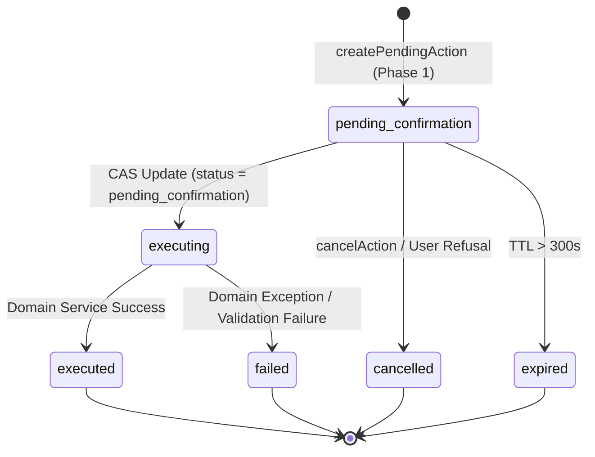

# ARKPET — R41.E ARCHITECTURE SPECIFICATION
## SAFE ACTIONS: CONTROLLED MUTATIONS, EXPLICIT CONFIRMATION, RBAC, IDEMPOTENCY & AUDIT

**Phase:** R41.E — Safe Actions  
**Program:** R41 — ArkPet Intelligent Assistant  
**Baseline Commit:** `ab539ae4504d8c18d192e0bd2416805789200f1f` (`R41_D_FINAL_SHA`)  
**Status:** Certified Architecture & Implemented  

---

## 1. Executive Summary

R41.E marks the transition of the ArkPet Intelligent Assistant from an informational, read-only guide into an authorized, domain-executing assistant. Because mutations carry operational, legal, and financial significance, **no database write or domain mutation is ever executed directly from model-generated text or unverified user intent**.

Every domain mutation strictly adheres to the **Two-Phase Action Protocol**:
1. **Phase 1: PREVIEW (Proposal & Reservation)**  
   The assistant validates schema, checks server RBAC and tenant authorization, inspects canonical domain prerequisites, calculates an opaque SHA-256 payload integrity hash, and stores an expiring `pending_confirmation` record (TTL = 300s). No database mutation occurs in Phase 1.
2. **Phase 2: EXECUTE (Confirmation & CAS Transition)**  
   Upon explicit user approval (via structured UI button or unambiguous voice/natural language confirmation), the server validates the pending action token, rechecks tenant/user binding, acquires an atomic compare-and-swap (CAS) lock, revalidates domain state under row locks, executes the canonical domain service, records an immutable audit trail, and returns the result.

```
USER REQUEST
   ↓
ASSISTANT INTENT RESOLUTION
   ↓
REGISTERED MUTATION TOOL (1 of 7 Canonical Tools)
   ↓
SERVER AUTHENTICATION & RBAC (Server-Enforced)
   ↓
TENANT & OWNERSHIP VALIDATION
   ↓
DOMAIN STATE PREREQUISITE CHECK
   ↓
ACTION PREVIEW GENERATION (Opaque Token + Payload Hash)
   ↓
EXPLICIT USER CONFIRMATION (UI Button / Unambiguous Text)
   ↓
CONFIRMATION TOKEN VALIDATION (User/Tenant/Hash Binding)
   ↓
ATOMIC CAS LOCK (pending_confirmation → executing)
   ↓
IDEMPOTENCY VERIFICATION (Double-Click Prevention)
   ↓
CANONICAL DOMAIN SERVICE EXECUTION (Zero LLM Involvement)
   ↓
IMMUTABLE AUDIT LOGGING (assistant_safe_action_audit)
   ↓
SAFE STRUCTURED RESULT
```

---

## 2. Invariants & Guarantees

| Invariant | Value | Architectural Guarantee |
|---|---|---|
| `MUTATION_WITHOUT_CONFIRMATION` | `0` | Every single mutation requires explicit confirmation |
| `LLM_IN_MUTATION_EXECUTION_PATH` | `NO` | Execution after confirmation is 100% deterministic code |
| `GENERAL_DB_ACCESS_TOOL` | `0` | Prohibits SQL, raw queries, or generic database executors |
| `GENERIC_MUTATION_TOOL` | `0` | All mutations map to dedicated, narrowly typed tools |
| `MODEL_GENERATED_SQL_EXECUTION`| `0` | Zero eval, dynamic SQL, or raw ORM query building from model |
| `AI_DELETE_TOOL_COUNT` | `0` | Assistant cannot delete database rows or entities |
| `AI_FINANCIAL_MUTATION_TOOL_COUNT` | `0` | Billing/payment/financial writes are blocked |
| `STANDALONE_BATH_ACTION_TOOL` | `0` | Bath remains exclusively an add-on within booking flow |
| `MODEL_OVERRIDES_MEDICATION_DOSAGE`| `0` | Assistant cannot override medical dosage or frequency |
| `CONFIRMATION_TOKEN_USER_BOUND` | `YES` | Token valid only for the user who initiated the preview |
| `CONFIRMATION_TOKEN_TENANT_BOUND`| `YES` | Token valid only for the crecheId of the current tenant |
| `CONFIRMATION_TOKEN_EXPIRING` | `YES` | Token expires in exactly 300 seconds (5 minutes) |
| `CONFIRMATION_TOKEN_SINGLE_USE` | `YES` | Token cannot be confirmed multiple times for side effects |

---

## 3. Database Schema

The architecture introduces two relational tables managed through Drizzle ORM:

### 3.1. `assistant_pending_actions`
Stores action proposals awaiting explicit user confirmation:

```ts
export const assistantPendingActionsTable = pgTable("assistant_pending_actions", {
  id: varchar("id", { length: 64 }).primaryKey(), // pa_uuid
  userId: integer("user_id").notNull(),
  crecheId: integer("creche_id").notNull(),
  role: varchar("role", { length: 32 }).notNull(),
  actionType: varchar("action_type", { length: 64 }).notNull(),
  targetType: varchar("target_type", { length: 32 }).notNull(), // 'booking' | 'pet' | 'task'
  targetId: integer("target_id").notNull(),
  validatedPayload: jsonb("validated_payload").notNull(),
  payloadHash: varchar("payload_hash", { length: 64 }).notNull(), // sha256
  status: varchar("status", { length: 32 }).notNull().default("pending_confirmation"),
  previewData: jsonb("preview_data"),
  summary: text("summary").notNull(),
  requestId: varchar("request_id", { length: 64 }),
  expiresAt: timestamp("expires_at", { withTimezone: true }).notNull(),
  confirmedAt: timestamp("confirmed_at", { withTimezone: true }),
  executedAt: timestamp("executed_at", { withTimezone: true }),
  resultReference: jsonb("result_reference"),
  errorMessage: text("error_message"),
  createdAt: timestamp("created_at", { withTimezone: true }).defaultNow().notNull(),
  updatedAt: timestamp("updated_at", { withTimezone: true }).defaultNow().notNull(),
});
```

### 3.2. `assistant_safe_action_audit`
Provides an immutable, tamper-evident audit log of all preview, confirmation, execution, and rejection events:

```ts
export const assistantSafeActionAuditTable = pgTable("assistant_safe_action_audit", {
  id: serial("id").primaryKey(),
  pendingActionId: varchar("pending_action_id", { length: 64 }),
  actionType: varchar("action_type", { length: 64 }).notNull(),
  targetType: varchar("target_type", { length: 32 }).notNull(),
  targetId: integer("target_id").notNull(),
  actorId: integer("actor_id").notNull(),
  actorRole: varchar("actor_role", { length: 32 }).notNull(),
  crecheId: integer("creche_id").notNull(),
  status: varchar("status", { length: 32 }).notNull(), // 'preview_created' | 'executed' | 'cancelled' | 'failed' | 'denied'
  idempotencyKey: varchar("idempotency_key", { length: 64 }),
  details: text("details"),
  ipAddress: varchar("ip_address", { length: 64 }),
  userAgent: text("user_agent"),
  metadata: jsonb("metadata"),
  createdAt: timestamp("created_at", { withTimezone: true }).defaultNow().notNull(),
});
```

---

## 4. State Machine & Compare-And-Swap (CAS) Concurrency

Pending actions follow a deterministic finite state machine with atomic transitions:



### 4.1. Atomic Locking
To prevent double execution or race conditions:
```sql
UPDATE assistant_pending_actions
SET status = 'executing', updated_at = NOW()
WHERE id = $1 AND status = 'pending_confirmation'
RETURNING *;
```
If 0 rows are returned, the engine inspects the current state:
- If `status === 'executed'`, it returns the previously cached `resultReference` immediately (idempotency).
- If `status === 'cancelled'`, it throws `409 Conflict: Ação já cancelada`.
- If `status === 'failed'`, it throws `409 Conflict: Ação falhou anteriormente`.
- If `status === 'executing'`, it throws `409 Conflict: Ação em execução simultânea`.

---

## 5. Tool Registry Split (15 Tools Total)

In accordance with R41.E requirements:
- Certified Read-Only Tools (R41.D): **8**
- Certified Safe Mutation Tools (R41.E): **7**
- Total Registered Tools: **15**

```
R41_E_READ_ONLY_TOOL_COUNT = 8
R41_E_MUTATION_TOOL_COUNT = 7
R41_E_TOTAL_TOOL_COUNT = 15
```

The 8 Read-Only tools are preserved with 0 regressions:
1. `get_onboarding_status`
2. `get_current_user_context`
3. `get_current_screen_context`
4. `search_arkpet_knowledge`
5. `list_my_pets`
6. `list_my_bookings`
7. `get_guided_onboarding_plan`
8. `get_contextual_product_guide`

The 7 Safe Mutation tools are:
1. `cancel_my_booking`
2. `check_in_pet`
3. `check_out_pet`
4. `complete_operational_task`
5. `complete_feeding_task`
6. `record_medication_administration`
7. `complete_walk_task`
