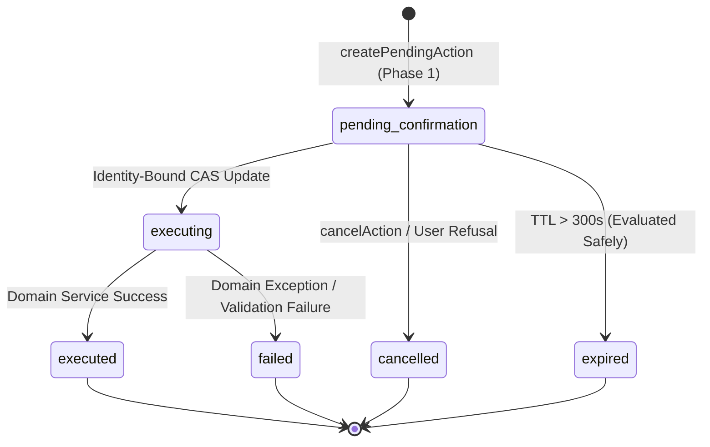

# ARKPET — R41.E AUDIT AND IDEMPOTENCY SPECIFICATION
## CAS STATE MACHINE, IMMUTABLE AUDIT TRAIL, IDEMPOTENCY ENGINE & LIFECYCLE MANAGEMENT

**Phase:** R41.E — Safe Actions (Finalized: R41.E-FINAL.2)  
**Program:** R41 — ArkPet Intelligent Assistant  
**Lineage & SHA Tracking:**
- `R41_D_FINAL_SHA`: `ab539ae4504d8c18d192e0bd2416805789200f1f`
- `R41_E_IMPLEMENTATION_SHA`: `55d228e41921302c794a35b4545d5af2efb8f255`
- `R41_E_FINAL1_HARDENING_SHA`: `9dc6583e16ac6e08e44224db5100c61b545f0126`
- `R41_E_FINAL1_CLOSURE_HEAD_SHA`: `9e0f689e7851b3d5fef0f13e42bad7648ae581c7`
- `R41_E_FINAL_SHA`: Forward commit HEAD (FINAL.2 Closure)  
**Status:** Certified Architecture & Implemented  

---

## 1. System Overview

Safe actions in ArkPet execute operations with direct domain and physical impacts—such as checking in an animal, recording prescribed medication administration, or cancelling reservations. To guarantee financial and operational integrity, the execution layer enforces two foundational guarantees:

1. **Strict Idempotency:** Any execution request can be repeated safely without causing duplicate actions, race conditions, or inconsistent state.
2. **Sanitized Immutable Auditability:** Every proposed, confirmed, cancelled, expired, or failed action generates an unmodifiable audit trail linking the requesting identity, payload hash, timestamps, and domain outcome, strictly sanitizing secrets and omitting raw stack traces.

---

## 2. Drizzle Database Schema

The safe action architecture is backed by two dedicated PostgreSQL tables defined in `lib/db/src/schema/assistantSafeActions.ts`:

### 2.1 Pending Actions (`assistant_pending_actions`)
Tracks the lifecycle of proposed mutations prior to and during execution:

```ts
export const assistantPendingActionsTable = pgTable(
  "assistant_pending_actions",
  {
    id: varchar("id", { length: 64 }).primaryKey(), // pa_<uuid>
    userId: integer("user_id").notNull(),
    crecheId: integer("creche_id").notNull(),
    role: varchar("role", { length: 32 }).notNull(),
    actionType: varchar("action_type", { length: 64 }).notNull(),
    targetType: varchar("target_type", { length: 64 }).notNull(),
    targetId: integer("target_id").notNull(),
    validatedPayload: jsonb("validated_payload").notNull().$type<Record<string, any>>(),
    payloadHash: varchar("payload_hash", { length: 64 }).notNull(), // SHA-256
    status: varchar("status", { length: 32 }).notNull().default("pending_confirmation"),
    previewData: jsonb("preview_data").notNull().$type<Record<string, any>>(),
    summary: text("summary").notNull(),
    requestId: varchar("request_id", { length: 64 }),
    createdAt: timestamp("created_at").notNull().defaultNow(),
    expiresAt: timestamp("expires_at").notNull(),
    confirmedAt: timestamp("confirmed_at"),
    executedAt: timestamp("executed_at"),
    resultReference: jsonb("result_reference").$type<Record<string, any>>(),
    errorMessage: text("error_message"),
  },
  (t) => [
    index("apa_user_status_idx").on(t.userId, t.status),
    index("apa_creche_idx").on(t.crecheId),
    index("apa_expires_idx").on(t.expiresAt),
    index("apa_target_idx").on(t.targetType, t.targetId),
  ]
);
```

### 2.2 Immutable Audit Trail (`assistant_safe_action_audit`)
An append-only log capturing all state changes and execution results:

```ts
export const assistantSafeActionAuditTable = pgTable(
  "assistant_safe_action_audit",
  {
    id: serial("id").primaryKey(),
    actionType: varchar("action_type", { length: 64 }).notNull(),
    actorUserId: integer("actor_user_id").notNull(),
    actorRole: varchar("actor_role", { length: 32 }).notNull(),
    crecheId: integer("creche_id").notNull(),
    targetType: varchar("target_type", { length: 64 }).notNull(),
    targetId: integer("target_id").notNull(),
    pendingActionId: varchar("pending_action_id", { length: 64 }),
    requestId: varchar("request_id", { length: 64 }),
    timestamp: timestamp("timestamp").notNull().defaultNow(),
    result: varchar("result", { length: 32 }).notNull(), // 'SUCCESS' | 'FAILURE' | 'DENIED'
    beforeState: jsonb("before_state").$type<Record<string, any>>(),
    afterState: jsonb("after_state").$type<Record<string, any>>(),
    idempotencyKey: varchar("idempotency_key", { length: 128 }).notNull(),
    details: text("details"),
    denialReason: text("denial_reason"),
  },
  (t) => [
    index("asaa_actor_idx").on(t.actorUserId),
    index("asaa_creche_idx").on(t.crecheId),
    index("asaa_pending_action_idx").on(t.pendingActionId),
    index("asaa_idempotency_idx").on(t.idempotencyKey),
    index("asaa_timestamp_idx").on(t.timestamp),
  ]
);
```

---

## 3. Compare-And-Swap (CAS) State Machine

Every action transitions through a deterministic state machine managed by atomic CAS updates in PostgreSQL:



### 3.1. Identity-Bound CAS Atomic Transition
To prevent race conditions, double clicks, and cross-user state poisoning:

```sql
UPDATE assistant_pending_actions
SET status = 'executing'
WHERE id = :pendingActionId
  AND status = 'pending_confirmation'
  AND user_id = :authenticatedUserId
  AND creche_id = :authenticatedCrecheId
  AND role = :authenticatedRole
  AND expires_at > NOW()
RETURNING *;
```

If exactly 1 row is returned, the caller holds the exclusive lock for execution.

### 3.2. Idempotent Replay Handling
If the atomic CAS returns 0 rows, the system queries the pending action scoped strictly by `id`, `user_id`, and `creche_id`:
- **If owned by user and `status === 'executed'`:** Replays the cached `resultReference` immediately with `replayed: true`. Domain mutation count remains strictly 1 (`R41E-FINAL1-IDEMPOTENCY-001 = PASS`).
- **If owned by user and `status === 'executing'`:** Returns HTTP `409 Conflict: Ação em execução simultânea.`
- **If owned by user and `status === 'cancelled'`:** Returns HTTP `409 Conflict: Ação já cancelada.`
- **If foreign or nonexistent ID:** Returns HTTP `404 pending_action_not_found`. Never reveals state or cached result to unauthorized callers (`CROSS_USER_IDEMPOTENT_RESULT_LEAK = 0`).

---

## 4. Audit Sanitization & Privacy Invariants

The audit service strictly cleanses all logged strings using `sanitizeAuditString`:
- **PostgreSQL Connection Strings:** Automatically redacted via `/postgres(ql)?:\/\/[^\s]+/gi`.
- **Bearer Tokens / Passwords:** Automatically stripped via regex.
- **Stack Traces:** Zero stack traces stored in `details` or `denialReason`. Only sanitized summary messages are persisted.

### Audit Immutability Truth:
- `APPLICATION_APPEND_ONLY_AUDIT = YES`: Application code exposes zero update or delete endpoints for `assistant_safe_action_audit`.
- `DATABASE_ENFORCED_AUDIT_IMMUTABILITY = NOT_PROVEN`: The database schema does not currently attach trigger-level or role-level `REVOKE UPDATE, DELETE` locks at the PostgreSQL catalog level.
- `AUDIT_SECRET_LEAK = 0`: Verified zero credentials leak in audit records.
- `AUDIT_STACK_TRACE_STORAGE = 0`: Verified zero stack traces stored.
