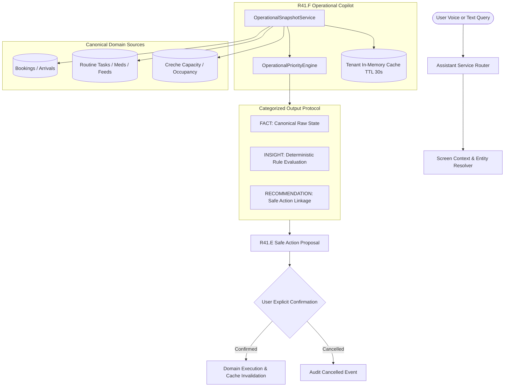

# ArkPet — R41.F Operational Copilot Architecture

## 1. Overview & Objectives

**Phase:** `R41.F — OPERATIONAL COPILOT`  
**Program:** `R41 — ARKPET INTELLIGENT ASSISTANT`  
**Baseline SHA:** `2887f09ea5aef06af4c77124a77f6d517e1ba0ce` (Certified R41.E Final)  
**Branch:** `development/arkpet-r41-intelligent-assistant`  

R41.F elevates the ArkPet Intelligent Assistant into a **proactive, contextual, and explainable Operational Copilot**. The copilot understands real-time daycare operations, surfaces actionable operational insights, computes deterministic priorities for routine daycare pendencies (medications, feedings, walks, arrivals), and bridges operational recommendations to R41.E Safe Actions without autonomous domain mutations.

---

## 2. Fundamental Architectural Invariants

| Invariant Code | Constraint Description | Status |
| :--- | :--- | :--- |
| `AUTONOMOUS_DOMAIN_MUTATION = 0` | The assistant cannot execute state mutations autonomously. | **ENFORCED** |
| `AUTONOMOUS_SAFE_ACTION_CONFIRMATION = 0` | Confirmation cards require explicit human user clicks. | **ENFORCED** |
| `GENERAL_DB_ACCESS_TOOL = 0` | Prohibits arbitrary SQL queries or ad-hoc table dumping tools. | **ENFORCED** |
| `GENERIC_ANALYTICS_TOOL = 0` | Prohibits generic data mining or report execution tools. | **ENFORCED** |
| `ASSISTANT_OPERATIONAL_SHADOW_DATABASE = 0` | Uses canonical database tables directly; zero secondary shadow stores. | **ENFORCED** |
| `MASTER_ADMIN_IMPLICIT_TENANT_CONTEXT = 0` | Master admin queries require explicit authorized `crecheId` context. | **ENFORCED** |
| `CROSS_TENANT_OPERATIONAL_READ = 0` | Tenant isolation strictly enforced on all queries and cache entries. | **ENFORCED** |
| `CROSS_TENANT_OPERATIONAL_ACTION = 0` | Safe actions verify target entity belongs to authorized tenant. | **ENFORCED** |
| `DATA_RETRIEVAL_FAILURE_INTERPRETED_AS_ZERO = 0` | Failures mark `dataCompleteness: "partial"`; submodels become `null` (not fake zero). | **ENFORCED** |
| `FAKE_OPERATIONAL_CAPACITY_FALLBACK = 0` | Prohibits hardcoded capacity fallback (e.g. 20); null when unqueried. | **ENFORCED** |
| `UNAVAILABLE_OPERATIONAL_SOURCE_NUMERIC_FALLBACK = 0` | Unavailable sources return null counts, not synthetic zero metrics. | **ENFORCED** |
| `INVENTED_OPERATIONAL_SLA = 0` | Zero fabricated escalation time thresholds (60/90/120 min removed). | **ENFORCED** |
| `UNSUPPORTED_CRITICAL_HEALTH_RISK_CLASSIFICATION = 0` | Zero unsupported critical labels without canonical domain source. | **ENFORCED** |
| `MODEL_SUPPLIED_OPERATIONAL_SESSION_ID = 0` | Public tool schema prohibits model-provided sessionId; server context bound. | **ENFORCED** |
| `OPERATIONAL_BASELINE_USER_BOUND = YES` | Session baselines verified against caller userId. | **ENFORCED** |
| `OPERATIONAL_BASELINE_TENANT_BOUND = YES` | Session baselines verified against caller crecheId. | **ENFORCED** |
| `OPERATIONAL_BASELINE_ROLE_BOUND = YES` | Session baselines verified against caller role. | **ENFORCED** |
| `UNREGISTERED_RECOMMENDED_ACTION = 0` | Recommended actions attach only certified R41.E safe action tools. | **ENFORCED** |
| `BULK_OPERATIONAL_AI_MUTATION = 0` | Rejects batch completion requests; enforces individual review. | **ENFORCED** |
| `MODEL_OVERRIDES_MEDICATION_DOSAGE = 0` | Medication dosages are immutable from medical records. | **ENFORCED** |

---

## 3. Strict Semantic Separation (Fact, Insight, Recommendation, Action)

R41.F strictly segregates operational output into four discrete tiers:

1. **`FACT`**: Verifiable data retrieved directly from canonical ArkPet database tables (e.g., current occupancy count, pending task records, scheduled times, check-in statuses).
2. **`INSIGHT`**: Deterministic interpretations computed by `OperationalPriorityEngine` based on canonical task priority and schedule (e.g., classifying overdue medication or overdue feeding as `high` priority).
3. **`RECOMMENDATION`**: Actionable suggestion linking to a specific registered tool (e.g., "Sugerir registro de administração de antibiótico").
4. **`ACTION`**: Execution of a registered tool via R41.E two-phase protocol (preview proposal $\to$ explicit confirmation $\to$ identity-bound execution $\to$ audit log).

---

## 4. Canonical Tool Registry Contract

R41.F maintains complete backward compatibility with certified R41.E tools while adding exactly 5 dedicated, read-only operational tools:

### Baseline Tools Preserved (15 Tools)
- **Read-Only (8):** `get_onboarding_status`, `get_current_user_context`, `get_current_screen_context`, `search_arkpet_knowledge`, `list_my_pets`, `list_my_bookings`, `get_guided_onboarding_plan`, `get_contextual_product_guide`.
- **Safe Mutation (7):** `cancel_my_booking`, `check_in_pet`, `check_out_pet`, `complete_operational_task`, `complete_feeding_task`, `record_medication_administration`, `complete_walk_task`.

### New Operational Read Tools (5 Tools)
1. `get_operational_overview`: Aggregates occupancy, arrivals, departures, routine tasks, and high-level priorities for the current business date.
2. `get_operational_priorities`: Returns sorted list of prioritized operational issues evaluated deterministically by urgency.
3. `get_today_arrivals`: Inspects expected daycare/hotel arrivals, flags on-the-way ETA progress, and identifies pending check-ins.
4. `get_pending_operational_tasks`: Retrieves pending/overdue routine tasks filtered by type (`feeding`, `medication`, `walk`, `other`), pet, or overdue status.
5. `get_recent_operational_changes`: Compares current operational snapshot with server-bound session baseline to surface changes since last briefing (`MODEL_SUPPLIED_OPERATIONAL_SESSION_ID = 0`).

**Total Tools Available when Operational Copilot Enabled:** 20 tools.  
**Total Tools when Copilot Disabled (Default / Baseline):** 15 tools (Preserved 100%).

---

## 5. Cache Architecture & Invalidation Protocol

- **Tenant Isolation:** Cache map is keyed strictly by integer `crecheId`. Tenant A never shares cached items with Tenant B.
- **TTL:** 30 seconds (`ASSISTANT_CONFIG.operationalCacheTtlSeconds = 30`).
- **Safe Action Invalidation:** Every successful confirmation of an operational safe action (`check_in_pet`, `check_out_pet`, `complete_feeding_task`, `record_medication_administration`, `complete_walk_task`, `complete_operational_task`) automatically calls `OperationalSnapshotService.invalidateCache(crecheId)` (`SAFE_ACTION_OPERATIONAL_CACHE_INVALIDATION = PASS`).
- **Session Baseline Tracking:** Session snapshots are preserved in-memory bound to `SessionBaselineContext` (`sessionId`, `userId`, `crecheId`, `role`). If no previous overview exists in the active session, a safe explanation is returned: `"Nenhum resumo operacional anterior nesta sessão para comparação."`.

---

## 6. Frontend Presentation Architecture

The PetDaycare web application integrates the operational copilot seamlessly in `AssistantConversation.tsx`:
- **Contextual Suggestions:** Surfaces operational quick prompts ("Resumo operacional de hoje", "O que precisa da minha atenção agora?") for `staff` and `creche_admin`.
- **Operational Card:** Renders structured operational overview widgets with real-time metrics (occupancy, arrivals, tasks, overdue counts), gracefully showing `Indisponível` for failed sources.
- **Priority Action Badges:** Categorizes issues by severity badges (`HIGH`, `MEDIUM`, `LOW`) with direct action suggestion buttons that route to R41.E proposal generation. Zero unsupported `critical` items are displayed without canonical basis.
- **Data Completeness Indicators:** Renders explicit `Dados Parciais` warnings when an underlying query source is unreachable.
