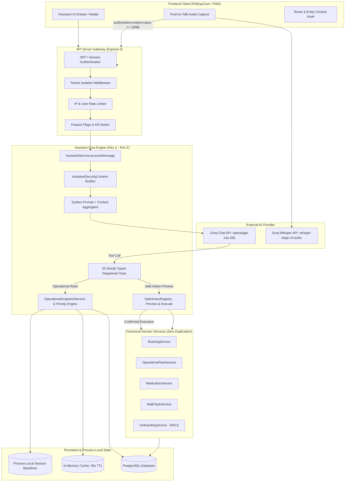

# ArkPet — R41.G Architecture Review
## Integrated Architecture: R41.A through R41.F

---

## 1. Executive Summary

Phase **R41.G** represents the **Integrated Final Certification, Cross-Phase Security Regression, and Release Freeze** for the **ArkPet Intelligent Assistant (R41)** program. R41 delivers an enterprise-grade, privacy-first, multi-role AI assistant deeply integrated into the ArkPet day-care management platform without introducing autonomous mutation risk or bypassing domain logic.

This document reviews the end-to-end architecture across all certified phases:
- **R41.A:** Intelligent Assistant Foundation (Secure LLM Gateway, Tool Dispatch, Fail-Closed Security, Audit Trail)
- **R41.B:** Guided Onboarding (Canonical R40.E Delegation, Role-Scoped creche_admin Checklists)
- **R41.C:** Contextual Product Guide (Active Screen & Entity Context, Role-Filtered Assistance, Exact 20 Registry Definitions)
- **R41.D:** Voice Assistant (Push-to-Talk, Ephemeral In-Memory Audio <= 10 MB, Whisper STT, Audio Privacy)
- **R41.E:** Safe Actions (Two-Phase Preview & Execution, Compare-And-Swap Concurrency, Domain Service Re-Use)
- **R41.F:** Operational Copilot (Deterministic Real-Time Prioritization, Server-Bound Session Deltas, Truthful Data Completeness)
- **R41.G:** Final Hardening, Cross-Phase Certification, and Release Freeze

---

## 2. System Architecture & Component Model

---

## 3. Subsystem Architectural Reviews

### 3.1 R41.A — Intelligent Assistant Foundation
- **Provider Layer:** Defaults to Groq (`openai/gpt-oss-20b`) in source code (`assistant.config.ts`). Fully fails closed on provider error (`PROVIDER_FAILURE_DOMAIN_MUTATION = 0`, `PROVIDER_FAILURE_FAKE_SUCCESS = 0`). Zero autonomous fallback to secondary providers that might violate privacy boundaries (`RUNTIME_FALLBACK_PROVIDER = NONE`).
- **Prompt Engineering:** Strict system instructions enforcing tone, domain terminology, canonical roles, anti-hallucination protocols, and fail-closed security.
- **Streaming & Non-Streaming:** Supports chunked SSE streaming with guaranteed audit log emission upon stream termination.

### 3.2 R41.B — Guided Onboarding
- **Canonical Delegation:** Does not reimplement onboarding logic (`DUPLICATE_ONBOARDING_COMPLETION_ENGINE = 0`). Delegates entirely to the canonical R40.E `OnboardingService`.
- **Role Scope Truth:** Canonical guided-onboarding tools (`get_onboarding_status` and `get_guided_onboarding_plan`) are strictly authorized for `creche_admin` in source code. They guide facility setup (profile, capacity, pricing, schedules). Other roles do not invoke these administrative onboarding checklist tools (`DOCUMENTED_GUIDED_ONBOARDING_ROLE_SCOPE_MATCHES_SOURCE = YES`).

### 3.3 R41.C — Contextual Product Guide
- **Screen Registry Truth:** Certified against `AssistantProductContextRegistry` (`assistant-context-registry.service.ts`) containing exactly 20 screen context definitions with complete matcher regular expressions and route aliases:
  1. `dashboard`: Matcher `/^\/(dashboard)?$/` — Matches path `/` and presentation alias `/dashboard`.
  2. `pets.list`: Matcher `/^\/pets$/` — Matches `/pets`.
  3. `pets.detail`: Matcher `/^\/pets\/(\d+)$/` — Matches `/pets/:id`.
  4. `bookings.list`: Matcher `/^\/bookings$/` — Matches `/bookings`.
  5. `bookings.new`: Matcher `/^\/bookings\/new$/` — Matches `/bookings/new`.
  6. `staff.board`: Matcher `/^\/(staff\/board|staff|walks)$/` — Matches `/staff`, `/staff/board`, and alias `/walks`.
  7. `staff.manage`: Matcher `/^\/staff\/manage$/` — Matches `/staff/manage`.
  8. `staff.qr_scanner`: Matcher `/^\/staff\/qr-scanner$/` — Matches `/staff/qr-scanner`.
  9. `tutors.list`: Matcher `/^\/tutors$/` — Matches `/tutors`.
  10. `chat`: Matcher `/^\/chat$/` — Matches `/chat`.
  11. `settings`: Matcher `/^\/settings$/` — Matches `/settings`.
  12. `financial`: Matcher `/^\/financial$/` — Matches `/financial`.
  13. `tutor.financial`: Matcher `/^\/tutor\/financial$/` — Matches `/tutor/financial`.
  14. `tutor.store`: Matcher `/^\/tutor\/store$/` — Matches `/tutor/store`.
  15. `billing`: Matcher `/^\/assinatura(\/sucesso)?$/` — Matches `/assinatura` and `/assinatura/sucesso`.
  16. `marketing.campaigns`: Matcher `/^\/marketing\/campaigns$/` — Matches `/marketing/campaigns`.
  17. `admin.creches`: Matcher `/^\/admin(\/creches)?$/` — Matches `/admin` and `/admin/creches`.
  18. `admin.campaigns`: Matcher `/^\/admin\/campaigns$/` — Matches `/admin/campaigns`.
  19. `admin.proposals`: Matcher `/^\/admin\/proposals$/` — Matches `/admin/proposals`.
  20. `admin.users`: Matcher `/^\/admin\/users$/` — Matches `/admin/users`.
- **Zero Fictitious Application Routes:** Certified against `App.tsx`. The application does NOT register fictitious routes (such as unmapped calendar or creche settings paths), nor an explicit React route `/dashboard` (`DOCUMENTED_FICTITIOUS_APP_ROUTE_COUNT = 0`, `CONTEXT_REGISTRY_DOC_MATCHES_SOURCE = YES`, `CONTEXT_REGISTRY_ALIAS_OMISSION_COUNT = 0`).
- **Entity Safety:** Active pet context is authenticated against tenant ownership. A tutor cannot pass another tutor's pet ID to acquire unauthorized context (`R41_G_CROSS_TENANT_READ = 0`).

### 3.4 R41.D — Voice Assistant
- **Microphone Permission:** Explicit user consent required on client (`VOICE_PERMISSION_EXPLICIT = YES`).
- **Push-to-Talk Exclusivity:** Zero background listening or continuous recording (`BACKGROUND_LISTENING = 0`).
- **Bounded Audio:** Maximum upload limit enforced at 10 MB (`voiceMaxUploadBytes = 10 * 1024 * 1024`, `VOICE_MAX_UPLOAD_MB = 10`), strictly rejecting larger payloads with HTTP 413.
- **Allowed MIME Types:** Strictly whitelisted in source (`voice.router.ts` & `assistant.config.ts`):
  - `audio/webm`
  - `audio/ogg`
  - `audio/wav`
  - `audio/mpeg`
  - `audio/mp4`
- **Audio Privacy:** Audio chunks are held strictly in memory during STT transit and discarded immediately. Zero raw sensitive audio stored in logs, disk, or database (`AUDIO_STORAGE_RETENTION = 0`).

### 3.5 R41.E — Safe Actions
- **Two-Phase Commit:** Every domain mutation requires explicit preview followed by authenticated human confirmation (`MUTATION_WITHOUT_CONFIRMATION = 0`).
- **LLM Decoupled from Execution:** The LLM only proposes the action; execution occurs via deterministic TypeScript handler validating canonical domain invariants without AI in the execution path (`LLM_IN_MUTATION_EXECUTION_PATH_AFTER_CONFIRMATION = NO`).
- **Compare-And-Swap (CAS):** Concurrency conflicts are prevented using entity version checks and user/tenant binding (`CAS_ATOMIC_AUTHORIZATION_BOUND = YES`).
- **Idempotency:** Action execution requires an idempotency token ensuring at-most-once execution.

### 3.6 R41.F — Operational Copilot
- **Deterministic Prioritization:** Operational priority is determined strictly by canonical task schedules, overdue status, and facility thresholds—never by LLM subjective judgment (`INVENTED_OPERATIONAL_SLA = 0`).
- **Truthful Data Interpretation:** Missing data or failed sub-queries are explicitly marked as `unavailableSources` and `null`; they are never defaulted to zero (`DATA_RETRIEVAL_FAILURE_INTERPRETED_AS_ZERO = 0`, `FAKE_OPERATIONAL_CAPACITY_FALLBACK = 0`).
- **Process-Local State:** Session baselines and 30-second operational snapshot caches are maintained in process memory and correctly documented as non-distributed.

### 3.7 R41.G — Final Hardening
- **Unbound Session Elimination:** Removed legacy `setSessionBaseline(string, ...)` and `getSessionBaseline(string)` overloads from `OperationalSnapshotService`. Only fully qualified `SessionBaselineContext` (`sessionId`, `userId`, `crecheId`, `role`) is accepted (`UNBOUND_OPERATIONAL_SESSION_API = 0`).

---

## 4. Current Tool Inventory (Exact 20 Tools Certified)

ArkPet R41 provides exactly 20 tools across 3 categories. Zero generic database access or arbitrary query tools exist (`GENERAL_DB_ACCESS_TOOL = 0`, `GENERIC_ANALYTICS_TOOL = 0`, `GENERIC_MUTATION_TOOL = 0`, `DOCUMENTED_NONEXISTENT_TOOL_NAMES = 0`).

### Category A: Baseline Read-Only Tools (8 Tools)
1. `get_onboarding_status`: Retrieves R40.E guided onboarding progress (`creche_admin`).
2. `get_current_user_context`: Inspects authenticated user role and identity.
3. `get_current_screen_context`: Returns contextual guidance for the current frontend view.
4. `search_arkpet_knowledge`: Queries versioned static knowledge (`arkpet-v32-r41c`).
5. `list_my_pets`: Returns tenant/user-owned pets with health summaries.
6. `list_my_bookings`: Returns scheduled day-care bookings for the authenticated scope.
7. `get_guided_onboarding_plan`: Returns full step-by-step onboarding plan (`creche_admin`).
8. `get_contextual_product_guide`: Returns detailed system guide for active view.

### Category B: Operational Read Tools (5 Tools)
9. `get_operational_overview`: Real-time census, occupancy, task counts, and alerts (`creche_admin`, `staff`).
10. `get_operational_priorities`: Deterministically ranked urgent tasks and schedule deadlines (`creche_admin`, `staff`).
11. `get_today_arrivals`: Scheduled, checked-in, and departing pets for current date (`creche_admin`, `staff`).
12. `get_pending_operational_tasks`: Pending feeding, walking, and care tasks (`creche_admin`, `staff`).
13. `get_recent_operational_changes`: Compares current operational state with session baseline (`creche_admin`, `staff`).

### Category C: Safe Action Mutation Tools (7 Tools)
14. `cancel_my_booking`: Tutor-facing cancellation subject to cancellation policy (`tutor`, `creche_admin`).
15. `check_in_pet`: Staff-facing pet arrival check-in with booking verification (`staff`, `creche_admin`).
16. `check_out_pet`: Staff-facing departure check-out (`staff`, `creche_admin`).
17. `complete_operational_task`: General care task completion (`staff`, `creche_admin`).
18. `complete_feeding_task`: Pet feeding administration recording (`staff`, `creche_admin`).
19. `record_medication_administration`: Medication administration logging with strict dosage enforcement (`staff`, `creche_admin`).
20. `complete_walk_task`: Pet walk activity recording (`staff`, `creche_admin`).

---

## 5. Deployment Architecture & Hosting Environment

### 5.1 Production Hosting Architecture
ArkPet uses a containerized full-stack deployment model:
- **Backend API:** Built to `dist/index.cjs` (2.9 MB bundle) executed via Node.js on port 8080 (`server.mjs` / container runtime).
- **Frontend SPA:** Built to `dist/public` and served statically via Express middleware.
- **Database:** Managed PostgreSQL instance accessed via Drizzle ORM.

### 5.2 Clarification on External Vercel Checks
- **Vercel Status:** `VERCEL_STATUS = FAILURE`.
- **Release Invariance:** Vercel is **NOT** the production deployment target or staging target for ArkPet. Vercel deployment is strictly non-blocking (`VERCEL_REQUIRED_FOR_ARKPET_RELEASE = NO`).
- **Root Cause Status:** `VERCEL_FAILURE_ROOT_CAUSE = NOT_FULLY_PROVEN` (unverified monorepo configuration on legacy third-party webhook trigger).

---

## 6. Architecture Review Sign-Off

The integrated architecture of R41.A through R41.F, as hardened in R41.G, complies with all security, privacy, performance, and stability guidelines.

**ARCHITECTURE STATUS:** **APPROVED & CERTIFIED**
