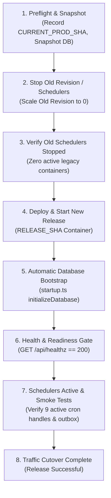
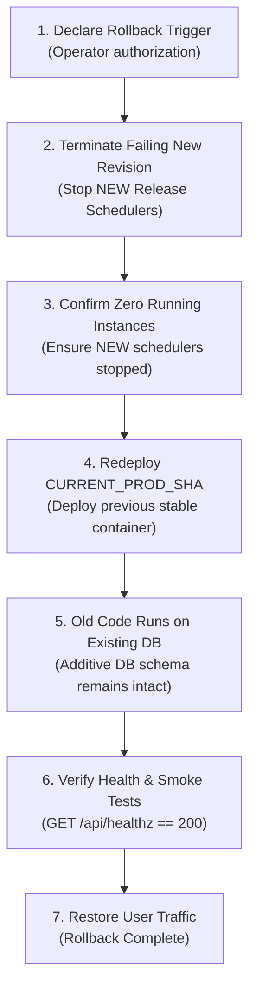

# ArkPet — Release & Rollback Operational Runbook

**Document Version:** 1.0.0  
**Phase Target:** Production Release Readiness (R10–R30 Cumulative Release)  
**Classification:** Operational Governance & Deployment Standard  
**Target File:** `docs/RELEASE_ROLLBACK_RUNBOOK.md`  

---

## 1. Purpose

This runbook defines the formal, executable, and reproducible operational procedures for releasing and rolling back the **ArkPet Platform**. It specifies exact preflight requirements, database compatibility rules, zero-overlap scheduler cutover mechanics, health verification gates, and code-only rollback workflows.

---

## 2. Scope

This runbook applies to:
- **Backend API Server:** `@workspace/api-server` (`artifacts/api-server/src/index.ts`).
- **Frontend SPA:** `@workspace/petdaycare` (`artifacts/petdaycare/server.mjs`).
- **Database Schema & Migrations:** `@workspace/db` (`artifacts/api-server/src/startup.ts`).
- **Background Schedulers & Outbox Workers:** (`artifacts/api-server/src/lib/scheduler.ts`).

---

## 3. Current Architecture

The production environment is hosted on a containerized infrastructure (`.replit` / Cloud Run deployment model):
- **Runtime:** Node.js 24 LTS, PNPM Workspace.
- **Backend Build:** Bundled with esbuild to `artifacts/api-server/dist/index.cjs` via `build.ts`.
- **Frontend Build:** Single Page Application (SPA) built with Vite to `artifacts/petdaycare/dist/public` and served by `artifacts/petdaycare/server.mjs` on port `PORT` (fallback `21324`).
- **Database:** PostgreSQL (Cloud-managed instance via `DATABASE_URL`).
- **Application Router:** Dispatches incoming HTTP traffic between the static frontend and the `/api` backend endpoints.

---

## 4. Release Identity & Tracking

Every deployment must be strictly pinned to immutable Git commit SHAs. Deployment by branch name alone (`latest`, `master`, `main`) without recording specific commit SHAs is **prohibited**.

### Mandatory Pre-Deployment Release Identity Checklist
- [ ] **`CURRENT_PROD_SHA`**: Captured and recorded from the live production service immediately before deployment.
- [ ] **`RELEASE_SHA`**: Captured and confirmed from the audited release commit (e.g., `3baccfca0f8e420d439d36b5b9db00d6320a610b`).
- [ ] **Integrity Confirmation**: `CURRENT_PROD_SHA` is non-empty and `RELEASE_SHA` has passed full canonical test suite verification (20 integration suites / 436 tests, 2 legacy live E2E suites / 35 tests, total 471 / 471 PASS).
- [ ] **Rollback Target Pinning**: `ROLLBACK_TARGET` is set explicitly to `CURRENT_PROD_SHA`.

> [!IMPORTANT]
> **Universal Rollback Rule:** Never assume `HEAD^` is the rollback target. If the running production container was deployed from an earlier commit, rolling back to `HEAD^` would deploy an unverified intermediate state. The rollback target must ALWAYS be the recorded `CURRENT_PROD_SHA`.

---

## 5. Environment Preflight

Before starting deployment, the operator must verify that all required environment variables are configured in the target environment.

### Environment Variable Matrix

| Variable | Classification | Purpose | Boot-Critical Failure Mode |
| :--- | :--- | :--- | :--- |
| `JWT_SECRET` | **BOOT CRITICAL** | Signing & verifying JWT authentication tokens | **Process Fast-Fail:** Exits immediately (`process.exit(1)`) on boot if missing/whitespace in production. |
| `DATABASE_URL` | **BOOT CRITICAL** | PostgreSQL pool connection URI | **Connection Failure:** Startup aborted during pool initialization or schema check. |
| `PASSWORD_SALT` | **FEATURE CRITICAL** | User password hashing reproducibility | Password verification fails if changed or omitted. |
| `PORT` | **OPTIONAL** | HTTP server port | Defaults to `8080` (API) / `21324` (Frontend). |
| `NODE_ENV` | **OPTIONAL** | Runtime environment mode | Controls production optimizations & seed execution (`production`). |
| `APP_URL` | **FEATURE CRITICAL** | CORS origin whitelist & links | Defaults to fallback; strict CORS blocks unauthorized web origins. |
| `REPLIT_DOMAINS` | **OPTIONAL** | Allowed CORS domains | Added to CORS allowed origins. |
| `VAPID_PUBLIC_KEY` | **OPTIONAL** | Web Push public key | Push notifications disabled with warning if missing. |
| `VAPID_PRIVATE_KEY`| **OPTIONAL** | Web Push private signing key | Push notifications disabled with warning if missing. |
| `VAPID_EMAIL` | **OPTIONAL** | Web Push contact address | Required for push subscription delivery headers. |
| `RESEND_API_KEY` | **OPTIONAL** | Transactional email delivery API key | Email sending degraded with warning if missing. |
| `RESEND_FROM_EMAIL`| **OPTIONAL** | Transactional email sender address | Email sending degraded with warning if missing. |
| `STRIPE_SECRET_KEY`| **OPTIONAL** | Stripe billing & payment intents | Stripe transactions fail gracefully if unconfigured. |
| `STRIPE_WEBHOOK_SECRET` | **OPTIONAL** | Stripe webhook signature verification | Webhook events rejected if invalid/missing. |
| `SESSION_SECRET` | **FEATURE CRITICAL** | Media token HMAC signing | Photo and feed media token signing fallback. |
| `ENCRYPTION_KEY` | **FEATURE CRITICAL** | Symmetric data encryption | Media token security fallback. |
| `PRIVATE_OBJECT_DIR` | **OPTIONAL** | Object storage local path fallback | Storage operations fall back to local disk. |
| `MASTER_ADMIN_EMAIL` | **BOOTSTRAP ONLY** | Initial master admin email | Used only when bootstrapping an empty database. |
| `MASTER_ADMIN_PASSWORD` | **BOOTSTRAP ONLY** | Initial master admin password | Used only when bootstrapping an empty database. |

### Secret Handling Policy
- **Never** output raw secret values in deployment logs, execution outputs, terminal transcripts, or release reports.
- Validate secrets using presence/length checks only (e.g., `JWT_SECRET: PRESENT (64 hex chars)`).

---

## 6. Database Backup Preflight

### Classification
- **Database Provider:** `<DATABASE_PROVIDER>` (Identified by operator from production configuration, e.g. Cloud-managed PostgreSQL).
- **Backup Mechanism:** Provider-Managed Snapshot / Point-In-Time Recovery (PITR).
- **Restore Capability:** Must be verified with the database provider before initial production migration.

### Pre-Deployment Backup Checklist
- [ ] Production database provider identified: `<DATABASE_PROVIDER>`.
- [ ] Automated backup / PITR status confirmed active.
- [ ] Manual pre-release database snapshot initiated before deployment.
- [ ] Snapshot identifier recorded: `<SNAPSHOT_ID>`.
- [ ] Confirmation that restore documentation/console access is available to the operator.

> [!CAUTION]
> If a database snapshot cannot be created or confirmed prior to deployment of major DDL additions, the deployment must be **HALTED** pending explicit written risk acceptance by the operations lead.

---

## 7. Database Compatibility Model

### Forward & Backward Compatibility Verification
All database schema changes in the R10–R30 release delta (managed via `artifacts/api-server/src/startup.ts`) are **strictly additive and idempotent**:
- `CREATE TABLE IF NOT EXISTS`: `financial_outbox`, `booking_services`, `pos_sale_operations`, `store_order_operations`, `catalogue_stock_transactions`, `tutor_service_credits`, `booking_service_credits`, `booking_credits`.
- `ALTER TABLE ... ADD COLUMN IF NOT EXISTS`: All added columns (`reminder_sent_at`, `pix_key`, `pix_name`, `discount`, `credits_released`, `refunded_quantity`, etc.) are either **`NULL`able** or declare a safe **`DEFAULT`**.
- `CREATE TYPE ... IF NOT EXISTS`: Enums created inside guarded `DO $$ BEGIN IF NOT EXISTS ... END $$;` blocks.
- **Destructive Operations Scan:** **ZERO** `DROP TABLE`, **ZERO** `DROP COLUMN`, **ZERO** destructive `ALTER TYPE`, **ZERO** `TRUNCATE`, **ZERO** destructive `DELETE`.

### Version Compatibility Matrix
| Application Code Version | DB Schema State | Compatibility Status | Operational Impact |
| :--- | :--- | :--- | :--- |
| **Old API** (`<CURRENT_PROD_SHA>`) | **Old DB** | `SUPPORTED` | Baseline production state. |
| **Old API** (`<CURRENT_PROD_SHA>`) | **New DB** (Post-Bootstrap) | `SUPPORTED` | **Enables Code-Only Rollback without DB restore.** Old code ignores new additive columns and tables. |
| **New API** (`<RELEASE_SHA>`) | **Old DB** (Pre-Bootstrap) | `TRANSIENTLY SUPPORTED` | Supported during boot; `initializeDatabase()` automatically brings schema up-to-date before HTTP listener opens. |
| **New API** (`<RELEASE_SHA>`) | **New DB** | `SUPPORTED` | Target production state. |

---

## 8. Scheduler Zero-Overlap Requirement (OPS-R32-001)

### The Mixed-Version Concurrency Risk
In release R30, distributed multi-instance synchronization was implemented using:
1. PostgreSQL advisory transaction locks (`pg_advisory_xact_lock(999100001)`) for daily task generation.
2. Durable database tracking via `tasks.reminder_sent_at` and `SELECT ... FOR UPDATE` row locks for task reminders.

The legacy/older version of ArkPet did **not** use `tasks.reminder_sent_at` (used local memory) and did **not** acquire `DAILY_TASK_GENERATION_LOCK_KEY`.

> [!WARNING]
> **CRITICAL OPERATIONAL CONSTRAINT:**
> Because PostgreSQL advisory locks and row locks only coordinate processes that actively request them, an **OLD instance** running concurrently with a **NEW instance** will **NOT** be blocked by the new version's locks.
> - **Concurrent Task Reminders:** Old instance may re-send push notifications already processed by the new instance.
> - **Concurrent Daily Task Generation:** At 00:01, both old and new instances could generate duplicate feeding and walk tasks.

### Mandatory Zero-Overlap Cutover Rule
**NEVER run Old Version Schedulers and New Version Schedulers concurrently.**
Deployments must enforce a **Zero-Overlap Cutover Strategy** (Recreate / Cutover Deployment):
`STOP OLD REVISION -> CONFIRM ZERO ACTIVE OLD SCHEDULERS -> START NEW REVISION`.

> [!NOTE]
> Enforcing zero-overlap may introduce a brief maintenance window (typically 15–60 seconds). In business-critical operations, **data correctness and zero duplicate charges/reminders strictly supersede zero-downtime claims**.

---

## 9. Deployment Procedure (Step-by-Step)



### Phase 1: Pre-Deployment Preparation
1. Record `CURRENT_PROD_SHA` and `RELEASE_SHA`.
2. Perform environment variable preflight check.
3. Trigger manual pre-release database backup snapshot on `<DATABASE_PROVIDER>` and record `<SNAPSHOT_ID>`.
4. Validate that the release container image/build corresponds exactly to `RELEASE_SHA`.

### Phase 2: Old Instance Teardown (Zero-Overlap Enforcement)
1. Initiate shutdown of the active production container revision (`CURRENT_PROD_SHA`).
2. Allow up to 10 seconds for graceful shutdown (`SIGTERM` triggers `stopAllSchedulers()`, drains active HTTP connections, and closes DB pool).
3. Confirm in the platform console/logs that the old instance has terminated and **zero instances** of the old revision are executing.

### Phase 3: New Release Provisioning & DB Bootstrap
1. Deploy the new container revision pinned to `RELEASE_SHA`.
2. On boot, before accepting traffic, `src/index.ts` automatically executes `initializeDatabase()` from `src/startup.ts`:
   - Validates `JWT_SECRET` fail-fast configuration.
   - Executes idempotent DDL statements (`financial_outbox`, `booking_services`, `invoices`, `tasks`, etc.).
   - Seduces/updates plan definitions and plan pricing.
3. Verify startup logs confirm clean schema execution:
   `[startup] Planos verificados — ... plano(s) sincronizados.`

### Phase 4: Application Readiness Gate
1. Execute Application Readiness Check against the new instance:
   `GET /api/healthz`
2. Confirm HTTP status `200 OK` with payload `{"status":"ok"}`.
3. If `/api/healthz` returns `503` or fails to respond within the startup grace period, **DO NOT ROUTE USER TRAFFIC**. Proceed to the Abort / Rollback procedure.

### Phase 5: Schedulers Activation & Background Workers
1. As the HTTP listener starts, `src/index.ts` registers all 9 background cron tasks:
   - `startScheduler()` (Task reminders & check-in generation).
   - `startMensalidadeScheduler()` (Monthly subscription billing).
   - `startScheduledPlanChangeApplicator()` (Scheduled plan transitions).
   - `startPastDueSuspender()` (Inadimplência suspension).
   - `startTrialExpirationJob()` (Trial account expiration).
   - `startReceiptCleanupJob()` (Thermal receipt temporary image cleanup).
   - `startExpiredOrderCanceller()` (Store order expiration).
   - `startOutboxWorker()` (Transactional financial outbox dispatch).
   - `initStripe()` (Stripe recurring price synchronization).
2. Confirm startup logs show all schedulers initialized without error.

### Phase 6: Traffic Cutover & Frontend Switch
1. Direct production ingress / domain routing to the new container revision.
2. Verify frontend single-page application loads successfully and communicates with the backend API.

---

## 10. Health & Traffic-Cutover Policy (OPS-R32-002)

### Health Endpoint Behavior
- **Endpoint:** `GET /api/healthz`
- **Healthy (DB Reachable):** `HTTP 200` `{"status":"ok"}`
- **Unhealthy (DB Inaccessible):** `HTTP 503` `{"status":"unavailable"}` (sanitized error; does not leak credentials).

### Probe Usage Rules
1. **Application Readiness / Traffic-Cutover Gate:** `/api/healthz` must be used to determine if a newly deployed container is ready to receive user requests. Traffic must not be routed until `/api/healthz` returns `200`.
2. **Liveness Probe Restriction:** **DO NOT** configure `/api/healthz` as an aggressive, unbuffered liveness probe in the container orchestrator.
   > [!CAUTION]
   > Because `/api/healthz` executes `SELECT 1` against the database, a transient database network spike would cause all API replicas to return 503 simultaneously. If configured as an immediate liveness probe, the orchestrator would kill and restart all containers at once, triggering a catastrophic **Restart Storm**.
   > If liveness monitoring is required, configure high failure thresholds (e.g., 5+ consecutive failures over 60s) or utilize a process-only health endpoint.
3. **Process-Only Liveness Note:** A process-only liveness endpoint (checking Event Loop without database dependency) is not currently defined in the application and should be scheduled for future operational improvements if required by the infrastructure.

---

## 11. Immediate Smoke Tests (0–15 Minutes Post-Deploy)

Perform the following **non-destructive, read-only** validation checks immediately after cutover:

- [ ] **Health Endpoint**: `curl -f https://<APP_URL>/api/healthz` returns `200 OK`.
- [ ] **Frontend Assets**: Web application loads in browser; assets (`/assets/*.js`, `/assets/*.css`) load with `200 OK`.
- [ ] **Authentication & JWT**: Log in with administrative test credentials; verify JWT is issued and stored.
- [ ] **Multitenant Context**: Access the dashboard; confirm creche tenant data is scoped correctly without cross-tenant leakage.
- [ ] **Financial Dashboard (Read-Only)**: Open `/financial`; verify balance indicators and smart metrics render without console errors.
- [ ] **Scheduler Registration**: Verify stdout logs confirm all 9 cron tasks registered and active.
- [ ] **Outbox Polling**: Confirm `financial_outbox` worker is running every 5 seconds without unhandled exceptions.

> [!CAUTION]
> **Prohibited Smoke Tests in Production:**
> DO NOT create real Stripe charges, fake POS counter transactions, fake invoice payments, or test stock decrements in the production environment as part of smoke testing. Use read-only verification only.

---

## 12. Delayed Operational Checks (24h–30d Observation Window)

Certain asynchronous background workflows execute only on specific schedules. The release verification state remains **`DELAYED JOBS PENDING OBSERVATION`** until the following milestones are observed in production logs:

| Window | Scheduled Workflow | Verification Target |
| :--- | :--- | :--- |
| **Hourly** | `startPastDueSuspender` | Log confirmation of past-due subscription check without database deadlocks. |
| **Hourly** | `sendInvoiceReminders` | Log confirmation of pending invoice reminder scan. |
| **Daily (00:01 BRT)** | `generateDailyTasks` | Log confirmation: `[scheduler] Gerou X tarefa(s) para YYYY-MM-DD` with advisory lock acquired cleanly. |
| **Daily (03:00 BRT)** | `startReceiptCleanupJob` | Log confirmation of thermal receipt temp file cleanup. |
| **Monthly (1st, 02:00)** | `startMensalidadeScheduler` | Log confirmation of monthly subscription cycle invoice generation. |

### Release Verification Status Lifecycle
1. **`DEPLOYED / IMMEDIATE CHECKS PASS`**: Immediate smoke tests completed successfully (0–15 min).
2. **`DELAYED JOBS PENDING OBSERVATION`**: Monitoring 00:01 daily task generation and hourly outbox/reminders (24–48h).
3. **`FULL OPERATIONAL OBSERVATION COMPLETE`**: All background lifecycle jobs observed executing without defects.

---

## 13. Rollback Triggers

A rollback must be initiated immediately if any of the following conditions occur post-cutover:

1. **Persistent Health Failure:** `/api/healthz` returns `503` or timeouts for > 2 minutes after startup.
2. **Crash Loop / Startup Failure:** New revision crashes during `initializeDatabase()` or JWT validation.
3. **Authentication Failure:** Users cannot log in or valid JWTs are rejected.
4. **Tenant Isolation Defect:** Data from one creche is visible to another creche (P0 security regression).
5. **Financial Outbox Failure:** Outbox worker encounters deadlocks or fatal transaction aborts.
6. **Scheduler Duplication:** Duplicate task reminders or duplicate daily tasks are detected.
7. **Accidental Mixed-Version Concurrency:** Old and new revisions observed running concurrently.

---

## 14. Code-Only Rollback Procedure

Because all database schema changes in ArkPet are forward-compatible, rolling back does **NOT** require restoring a database snapshot or running schema downgrade scripts. Rollback is executed entirely at the application code level (**Code-Only Rollback**).



### Step-by-Step Rollback Execution
1. **Declare Rollback:** Document trigger in the incident log.
2. **Stop New Revision:** Terminate all running instances of the failing revision (`RELEASE_SHA`) to immediately halt failing schedulers.
3. **Enforce Zero-Overlap:** Verify that zero instances of `RELEASE_SHA` are active.
4. **Deploy Rollback Target:** Deploy the container image pinned to `ROLLBACK_TARGET` (`CURRENT_PROD_SHA`).
5. **Keep Existing Database:** Do **NOT** revert database DDLs or restore database backups. The older application code runs safely with the additive schema.
6. **Verify Health:** Confirm `GET /api/healthz` returns `200 OK` on the rolled-back instance.
7. **Route Traffic:** Direct production domain ingress back to the stable revision.
8. **Perform Smoke Verification:** Confirm login, dashboard access, and scheduler operation on the restored version.

---

## 15. Partial Deployment Failure Handling

If deployment fails during container startup or database bootstrap (Phase 3) before user traffic is switched:
1. **Do Not Panic:** User traffic is still routed to the old version or held at ingress.
2. **Abort New Container:** Terminate the failing new container instance.
3. **Database Evaluation:** If `initializeDatabase()` partially executed DDLs, the additive nature of the changes ensures the existing production version remains 100% functional.
4. **Redeploy / Maintain Old Revision:** Ensure `CURRENT_PROD_SHA` is active and healthy.

---

## 16. Accidental Mixed-Version Incident Procedure

If it is discovered that both `CURRENT_PROD_SHA` and `RELEASE_SHA` containers are running simultaneously with active schedulers:
1. **Immediate Action:** Terminate the older revision (`CURRENT_PROD_SHA`) container immediately to stop uncoordinated legacy schedulers.
2. **Identify Impact Window:** Determine the exact time range where both revisions were active.
3. **Inspect Task Reminders:** Check if any duplicate push reminders were dispatched for tasks during the overlap window.
4. **Inspect Daily Tasks:** If overlap occurred at 00:01 BRT, execute a read-only query to check for duplicate task fingerprints (`petId`, `type`, `scheduledFor`):
   ```sql
   SELECT pet_id, type, scheduled_for, COUNT(*)
   FROM tasks
   WHERE scheduled_for >= CURRENT_DATE
   GROUP BY pet_id, type, scheduled_for
   HAVING COUNT(*) > 1;
   ```
5. **Deduplication:** The application includes an automatic deduplication cleanup routine (`deduplicateTasks()` in `scheduler.ts`), but any manual remediation must be reviewed by the lead engineer.

---

## 17. Observability & Incident Logging (OPS-R32-003)

### Available Monitoring Sources
- **Standard Console Logs:** Container `stdout` / `stderr` captured in cloud platform logging.
- **Structured Logs:** Logger output in `artifacts/api-server/src/lib/logger.ts`.
- **Health Check Endpoint:** Polling `/api/healthz`.
- **Financial Audit Log:** Database table `financial_logs` recording billing, invoice, and payment events.
- **Outbox Status:** Monitoring `financial_outbox` (`SELECT status, COUNT(*) FROM financial_outbox GROUP BY status;`).

### Incident Data to Record (Template)
During any deployment defect or rollback event, record:
- Incident Timestamp (UTC & BRT).
- Deployed `RELEASE_SHA` & Target `CURRENT_PROD_SHA`.
- Platform Revision ID.
- Exact error messages from startup / health probe (excluding secrets).
- Database migration status at failure point.
- Resolution steps taken.

---

## 18. Stop & Abort Conditions

### DO NOT DEPLOY IF:
- [ ] `CURRENT_PROD_SHA` has not been captured and recorded.
- [ ] `RELEASE_SHA` has not passed canonical regression testing (471 tests).
- [ ] Database provider is unknown or uncontactable.
- [ ] Manual database backup snapshot cannot be created when required.
- [ ] `JWT_SECRET` is missing or empty in production configuration.
- [ ] `DATABASE_URL` is missing or invalid.
- [ ] Zero-Overlap cutover cannot be enforced by the deployment workflow.

### ABORT DEPLOYMENT IMMEDIATELY IF:
- [ ] Old scheduler container cannot be terminated before new version starts.
- [ ] New revision crashes during `initializeDatabase()`.
- [ ] `/api/healthz` returns `503` or fails after the startup grace period.
- [ ] Critical authentication or multitenant isolation failure is observed during smoke tests.

---

## 19. Release Tag & Governance Policy (OPS-R32-004)

### Semantic Versioning Tag Convention
- Release tags follow Semantic Versioning: `v<MAJOR>.<MINOR>.<PATCH>`.
- Example for Program Refinement Releases: `v1.0.0-r30`.

### Tag Creation Governance
- **Prohibition:** Tags must **never** be created prior to full release commit verification, runbook approval, and explicit operator release authorization.
- **Tagging Command (Post-Authorization Only):**
   ```bash
   git tag -a v1.0.0-r30 -m "feat(release): finalize ArkPet R10-R30 product refinement" <RELEASE_SHA>
   ```
- **Push Policy:** `git push origin <tag_name>` is strictly prohibited until the deployment has passed immediate smoke testing in production.

---

## 20. Release Record Template

```markdown
### Release Execution Record

- **Release Date / Time:** <YYYY-MM-DD HH:MM BRT>
- **Operator Name:** <OPERATOR>
- **Release Target SHA (RELEASE_SHA):** 3baccfca0f8e420d439d36b5b9db00d6320a610b
- **Previous Production SHA (CURRENT_PROD_SHA):** <CURRENT_PROD_SHA>
- **Rollback Target SHA:** <CURRENT_PROD_SHA>
- **Database Provider:** <DATABASE_PROVIDER>
- **Pre-Deploy Snapshot ID:** <SNAPSHOT_ID>
- **Environment Preflight Result:** [ ] PASS / [ ] FAIL
- **Old Revision Teardown Verified:** [ ] YES (Zero running legacy instances)
- **New Revision Startup / DDL Result:** [ ] SUCCESS
- **Application Readiness (/api/healthz):** [ ] HTTP 200 OK
- **Schedulers Active (9 handles):** [ ] CONFIRMED
- **Immediate Smoke Tests (0–15 min):** [ ] ALL PASS
- **Release Status:** [ ] DEPLOYED / IMMEDIATE CHECKS PASS
- **Delayed Checks Observation Target:** <YYYY-MM-DD (24h-48h)>
- **Release Tag:** <TAG_NAME_IF_CREATED>
```

---

## 21. Rollback Record Template

```markdown
### Rollback Execution Record

- **Rollback Date / Time:** <YYYY-MM-DD HH:MM BRT>
- **Operator Name:** <OPERATOR>
- **Failed Release SHA:** <RELEASE_SHA>
- **Restored Stable SHA (CURRENT_PROD_SHA):** <CURRENT_PROD_SHA>
- **Rollback Trigger / Reason:** <TRIGGER_DESCRIPTION>
- **Database Schema State:** Forward-compatible schema preserved (No DB restore needed)
- **Failing Revision Teardown Confirmed:** [ ] YES
- **Restored Revision Startup Result:** [ ] SUCCESS
- **Restored Revision Health (/api/healthz):** [ ] HTTP 200 OK
- **Post-Rollback Smoke Tests:** [ ] ALL PASS
- **Incident Summary & Notes:** <INCIDENT_NOTES>
```
